# Lab 4: Combination Vault

**Author:** Hao Chen Xiong

## Part 1 (Week 1)

### A. Capacitive sensing

I no longer have the CRICKIT FeatherWing originally planned for this exercise, so the capacitive test needs the course's MPR121, borrowed. One electrode will connect by an alligator lead to exposed copper tape on an insulating surface; a second will connect to an isolated metal spoon, to compare a found object with the copper. Keep both untouched during startup so baseline measurement is not affected by a hand.

The vault itself no longer uses capacitive sensing: its confirmation input is now a SparkFun Qwiic Button, explained in [E](#e-multi-device-demo). The original `cap_test.py` targets MPR121; the vault code keeps an equivalent MPR121 test mode.

**Code:** [vault.py](vault.py), `make_touch()` and `check_part()`.

```bash
python -u vault.py --test touch --touch-board mpr121
```

### B. More sensors


#### APDS-9960 proximity

Code: [proximity_test.py](https://github.com/IRL-CT/Interactive-Lab-Hub/blob/Fall2025/Lab%204/proximity_test.py)

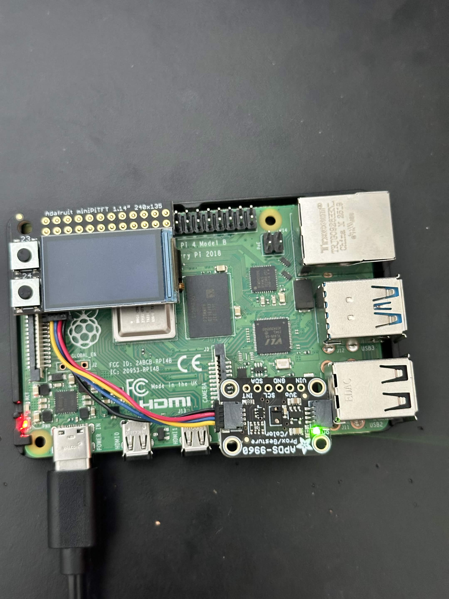

<a href="evidence/b-sensors/apds-proximity-demo.mp4">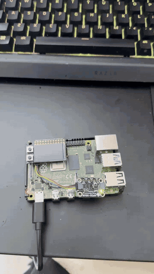</a>

Video: [approaching and withdrawing a hand](evidence/b-sensors/apds-proximity-demo.mp4).

Terminal output with nothing in front of the sensor:

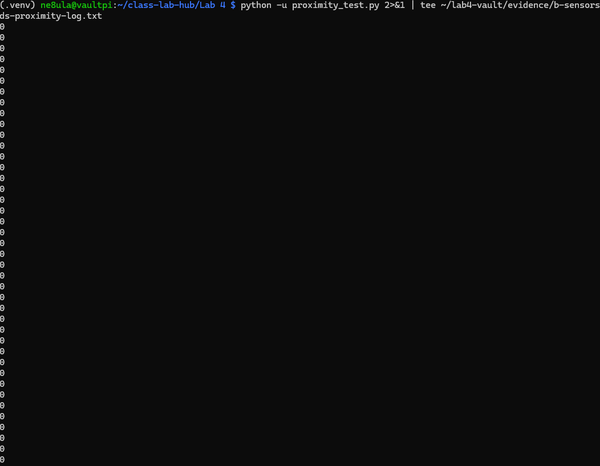

Terminal output while approaching and withdrawing:


The sensor reads 0 at rest, climbs to its maximum of 255 as a hand closes in, and returns to 0 on withdrawal. The rise is steep near the sensor, so the value is a relative closeness reading, not a distance.

#### APDS-9960 gesture

Code: [gesture_test.py](https://github.com/IRL-CT/Interactive-Lab-Hub/blob/Fall2025/Lab%204/gesture_test.py), run as `python -u gesture_test.py`. Same wiring as the proximity test above.

<a href="evidence/b-sensors/apds-gesture-demo.mp4">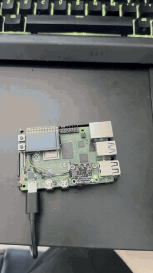</a>

Video: [swiping over the sensor](evidence/b-sensors/apds-gesture-demo.mp4).

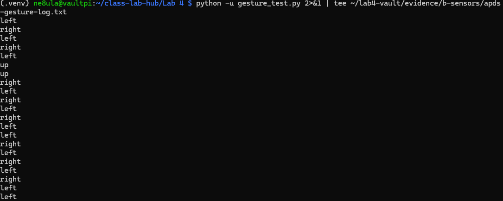

The sensor reported left and right swipes reliably and reported up twice. No down gesture appears in this run.

#### APDS-9960 color

Code: [color_test.py](https://github.com/IRL-CT/Interactive-Lab-Hub/blob/Fall2025/Lab%204/color_test.py)

<a href="evidence/b-sensors/apds-color-demo.mp4">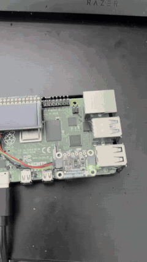</a>

Video: [holding objects over the sensor](evidence/b-sensors/apds-color-demo.mp4). The preview plays at 2x speed.

Representative readings from the terminal output, in the order they occurred:

| Phase | red | green | blue | clear | light lux |
|---|---|---|---|---|---|
| Open room light | 881 | 818 | 792 | 2272 | 425 |
| Green dominant | 26 | 106 | 40 | 160 | 130 |
| Green dominant, brighter | 174 | 248 | 129 | 441 | 241 |
| Dark, blue slightly highest | 10 | 20 | 24 | 59 | 11 |
| Red dominant | 283 | 78 | 88 | 368 | −33 |
| Open room light again | 988 | 918 | 892 | 2534 | 475 |

```
red:  283
green:  78
blue:  88
clear:  368
color temp 84332.88587558808
light lux -33.17400000000001
```

#### Rotary encoder: rotation, button and NeoPixel

Code: [encoder_test.py](https://github.com/IRL-CT/Interactive-Lab-Hub/blob/Fall2025/Lab%204/encoder_test.py), run as `python -u encoder_test.py`. The board is an Adafruit I2C QT rotary encoder (product 5880) on the Qwiic chain at address 0x36.

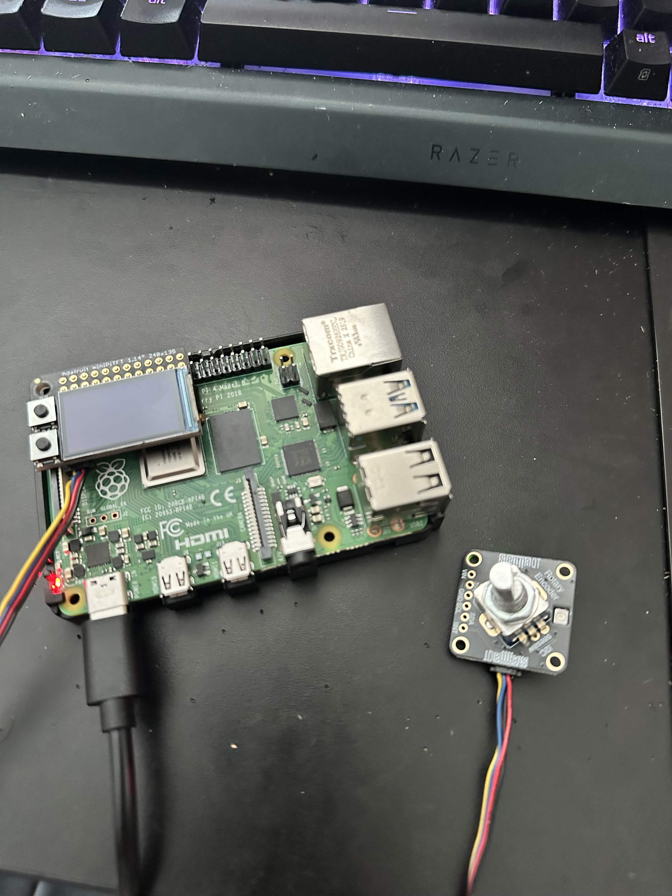

<a href="evidence/b-sensors/encoder-demo.mp4">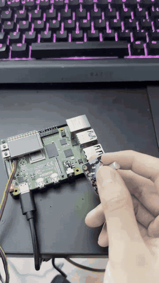</a>

Video: [turning the encoder](evidence/b-sensors/encoder-demo.mp4).

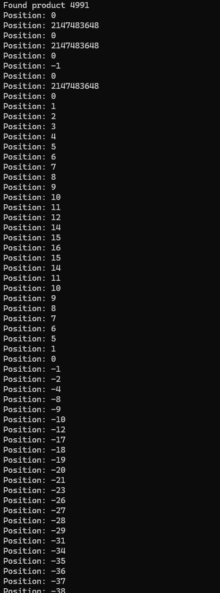

The script identified the board as product 4991. Turning clockwise counted up to 16 and turning counter-clockwise counted down past −38. Fast turns skipped numbers (12 to 14, 5 to 1, −12 to −17) because the script polls the position and does not report every detent. At startup the position read 2147483648 three times before settling at 0; that value is a failed position read, so an interaction should discard out-of-range readings.

**Button and NeoPixel.** Code: [vault.py](vault.py), run as `python -u vault.py --test encoder --encoder qt`. It reads the knob's push switch and sets the board's NeoPixel blue when idle and green while pressed.

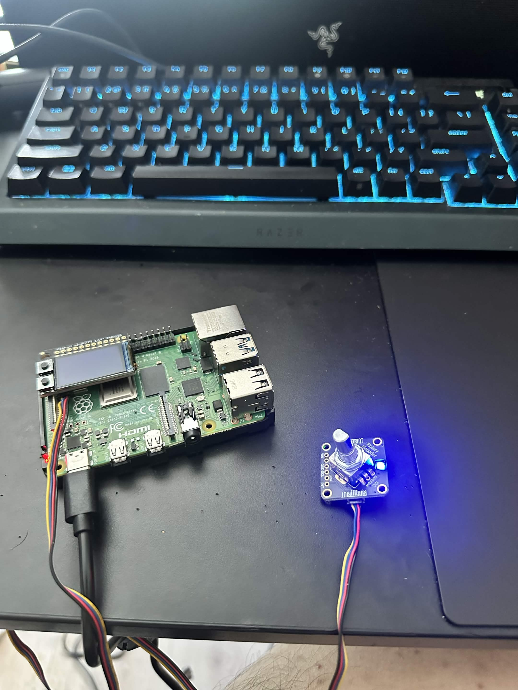 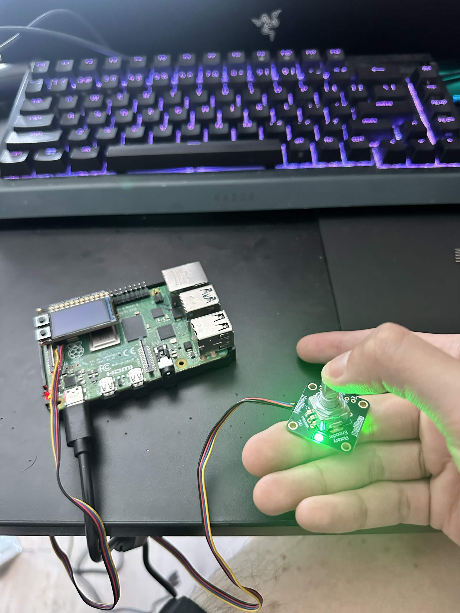

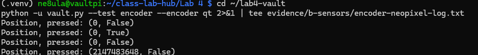

The terminal shows `pressed` going False, True, False as the knob was pushed and released, and the LED changed colour with it. The failed 2147483648 position read appeared here as well, so `vault.py` now ignores that value and keeps the last good position.

#### Qwiic joystick

Code: [joystick_test.py](https://github.com/IRL-CT/Interactive-Lab-Hub/blob/Fall2025/Lab%204/joystick_test.py), run as `python -u joystick_test.py`. The SparkFun Qwiic joystick is on the Qwiic chain at address 0x20.

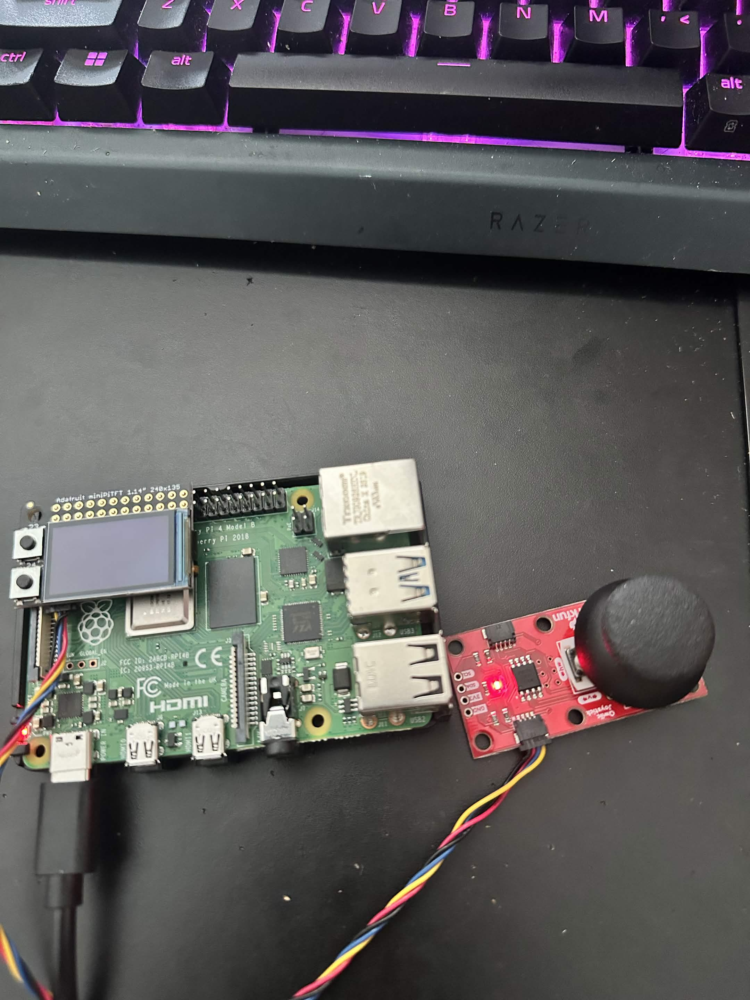

<a href="evidence/b-sensors/joystick-demo.mp4">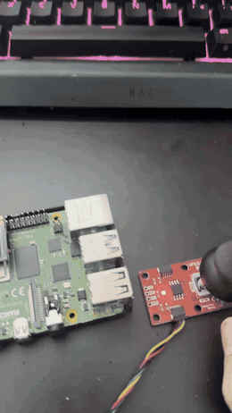</a>

Video: [moving the stick and pressing it](evidence/b-sensors/joystick-demo.mp4).

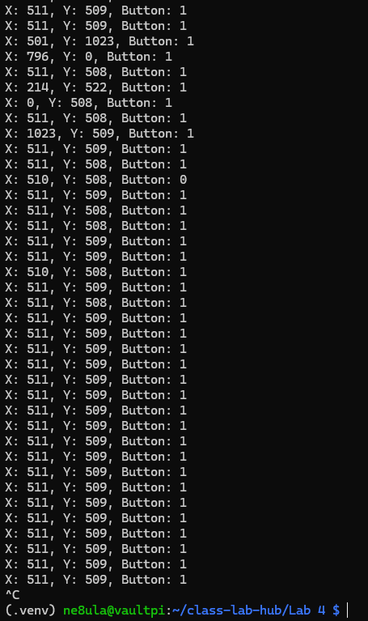

At rest the stick reads X 511, Y 509, with one count of jitter. Each axis reached both ends of its range: X went to 0 and 1023, Y went to 0 and 1023. The button reads 1 when released and 0 when pressed, so it is active-low. The script samples every half second, so quick flicks can fall between samples.

#### VCNL4040 distance sensor

Not done. I did not have this board.

### C. Physical sensing design

**Chosen Sensor: Rotary Encoder:** I chose the rotary encoder because turning is a familiar action that can support many different interactions, such as adjusting a lamp’s brightness, setting a timer, browsing music, entering a combination, or controlling a game (old ones like Pong). I’m interested in how changing the knob’s size, shape, and position affects how someone grips and uses it, and how the device’s response makes the effect of each turn clear.

The five sketches below explore setting a tempo, controlling a game, making beats, entering a code, and measuring a surface. These are my hand-drawn concepts.

#### C1. Visual Metronome

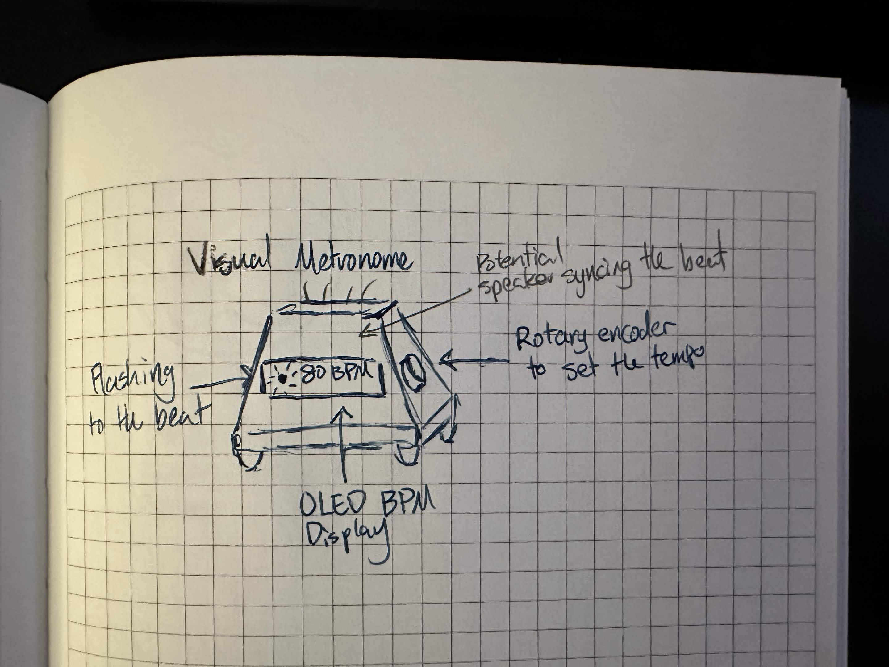

- **Sensors/Tech:** Rotary encoder connected to a Raspberry Pi to set the tempo. The Pi would schedule the beats and update an OLED; an optional powered speaker could add a matching click. The encoder’s push switch could start or pause the metronome.
- **Output:** The OLED shows the selected BPM and a flashing dot on each beat. If I add sound, the click should happen at the same time as the flash.
- **Form/Enclosure:** A tapered, upright enclosure with a broad base, a front-facing display and a dial on the side. I want the screen visible while practicing, with enough room to reach the dial without covering it.
- **Questions to Prototype:** Can I follow the flashing dot from a normal practice distance? Is the side dial comfortable to reach, and does turning it push the enclosure across the desk? I would make a cardboard stand to compare viewing angles and dial positions, then try slow and fast tempos to check the timing and any sound/flash mismatch.
- **Why is it Interesting:** I like that the same rotation produces both a number I can read and a rhythm I can follow. The familiar metronome shape also gives a clue about what the device does.
- **Notes:** Sound is optional in this sketch. I would start with the visual beat before adding audio.

#### C2. 2-Player Pong Emulator

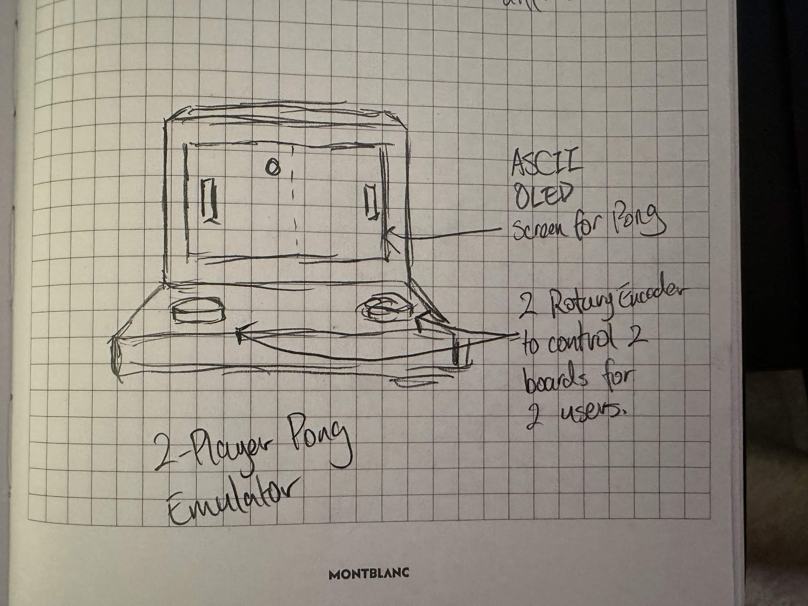

- **Sensors/Tech:** Two rotary encoders connected to one Raspberry Pi, one for each player. Turning an encoder moves that player’s paddle up or down. The Pi runs the game and draws a simple, ASCII-style Pong view on the OLED. An encoder push switch could start a round or restart after a game.
- **Output:** A shared display shows both paddles, the moving ball and the score. Each player should see their paddle respond while the other player is also turning their control.
- **Form/Enclosure:** A small arcade-style enclosure with an upright screen and a wide control deck. The two knobs sit apart so two people can stand or sit beside each other without their hands colliding.
- **Questions to Prototype:** Can both players see the ball clearly on the actual OLED? How much paddle movement should one encoder step produce? Is the control spacing comfortable, and does the box stay still during quick turns? I would mock up the control deck in cardboard and try simultaneous input with a simple moving paddle before building the full game.
- **Why is it Interesting:** Two people share the same object, but each has their own control. Small turns become quick reactions, so the size and placement of the knobs directly affect how the game feels.
- **Notes:** The drawn screen is conceptual; I still need to check whether the available OLED is large enough for two players. This would be a simple Pong-style recreation rather than emulation of original game hardware. Two encoders are two controls of the same sensor type.

#### C3. Beat Maker

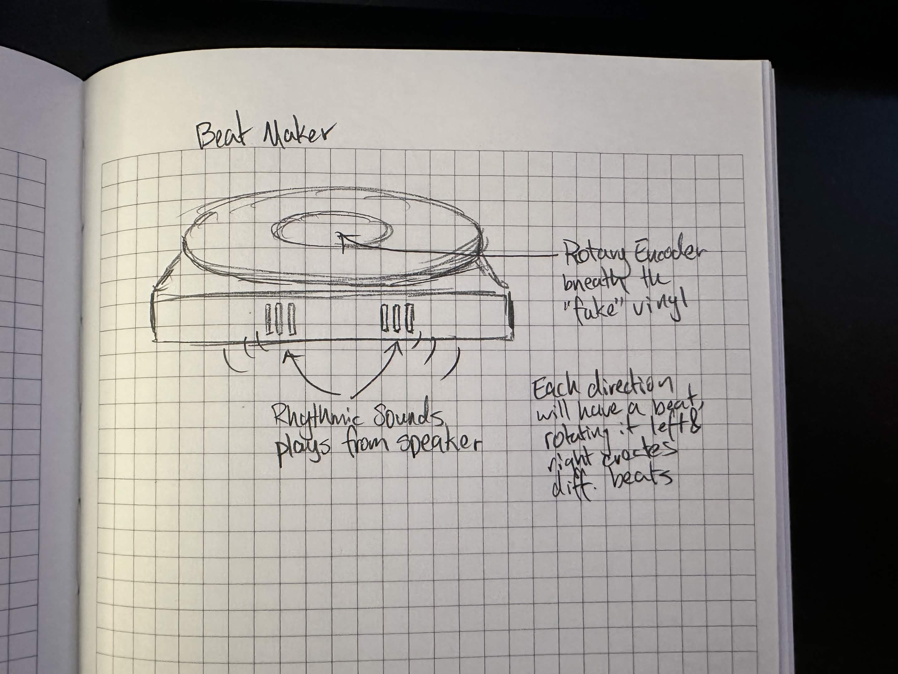

- **Sensors/Tech:** A rotary encoder coupled to a lightweight, vinyl-like disc, with a Raspberry Pi playing short audio samples through a powered speaker or an audio amplifier and speaker. Moving the disc left or right would trigger a different beat; I would start with one trigger when a movement begins or reverses.
- **Output:** Rhythmic sounds respond to the direction and timing of my hand movements. The main feedback is audio, so this concept does not need a screen.
- **Form/Enclosure:** A low, broad enclosure with the disc on top and speaker openings at the front. The disc needs support so pressing on its edge does not put all the force on the encoder shaft, and the base needs to resist sliding.
- **Questions to Prototype:** Does the disc turn comfortably with a fingertip, or do the encoder’s detents make it feel too stiff? How large should it be? Can the software recognize a deliberate reversal without producing several unwanted beats? I would try a supported cardboard disc first, then test slow and quick back-and-forth movements while listening for delay and repeated triggers.
- **Why is it Interesting:** Here, the encoder becomes a surface I can perform with. I can create a rhythm through the timing of my movements instead of using a knob to select a value.
- **Notes:** The disc is a physical controller, not a playable record. Triggering recorded beats is the starting idea; continuous vinyl-style audio scratching would be a separate extension.

#### C4. Combination Vault

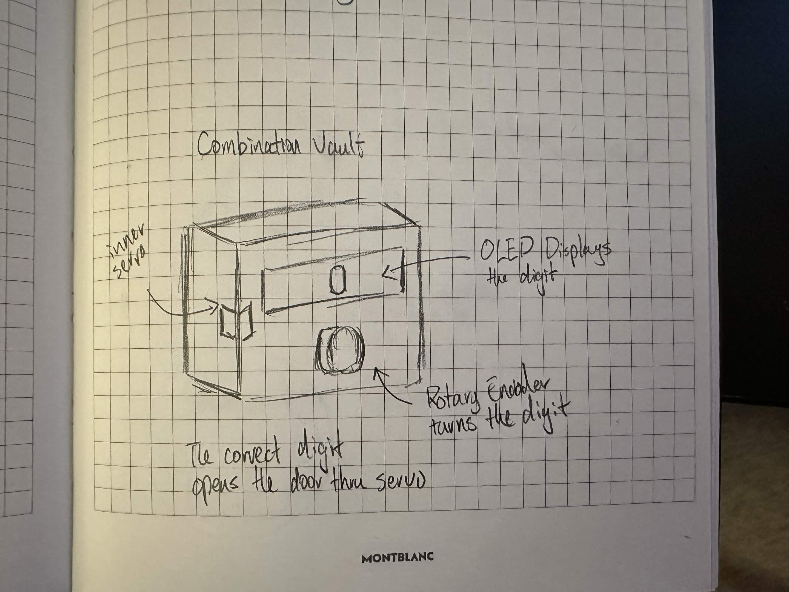

- **Sensors/Tech:** Rotary encoder and Raspberry Pi for selecting and checking digits, an OLED for feedback, and a servo with a suitable driver and power supply for the proposed door movement. I could use the encoder’s push switch to confirm a digit. A separate capacitive copper pad is another confirmation option for developing the multi-input version.
- **Output:** The OLED shows the current digit and whether the entry is accepted. In the sketch, a correct entry would make the servo open a lightweight door.
- **Form/Enclosure:** A small vault-shaped box with the display above the front dial and room for the door to swing. The physical arrangement should let me read the selected digit while turning, with clearance around the knob and access to the electronics from the back.
- **Questions to Prototype:** Can I stop on the intended digit without overshooting? Does pressing to confirm accidentally turn the dial? Would a separate touch pad make confirmation clearer? I would compare knob sizes and confirmation methods on a cardboard faceplate, then separately test a lightweight door and servo linkage for clearance and reliable movement.
- **Why is it Interesting:** The dial has a familiar role in a combination lock, and a successful entry leads to a visible physical result. It gives the interaction a clear sequence: choose, confirm, and discover whether the vault opens.
- **Notes:** This is a playful demonstration, not a security device.

#### C5. Measurement Roller

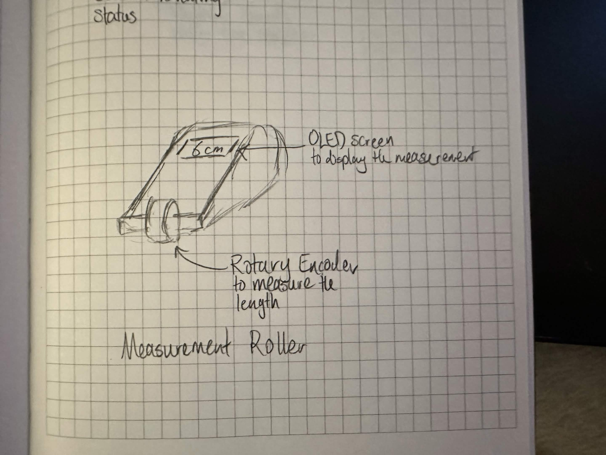

- **Sensors/Tech:** Rotary encoder coupled to a wheel, a Raspberry Pi to count movement, and an OLED to show the estimated distance. The calculation would use the wheel circumference and the number of encoder counts recorded for one full revolution. An accessible reset button could zero the measurement before each pass.
- **Output:** A distance estimate updates as the wheel rolls along a surface. Rolling backward could subtract from the reading so I can correct a small overshoot.
- **Form/Enclosure:** A handheld body with the wheel at the front, a grip at the back and an upward-facing display. The wheel must protrude far enough to stay in contact while the housing clears the surface, and the grip should leave the display visible.
- **Questions to Prototype:** Does the wheel roll without slipping on different surfaces? Do the encoder’s detents make it drag? Can I keep it straight while reading the display, and will the Pi and power cable make the grip awkward? I would try a simple supported wheel and handle, calibrate against a ruler, and repeat forward and backward passes over known lengths.
- **Why is it Interesting:** The encoder measures movement through the environment rather than a dial turned in place. The wheel, grip and contact with the surface are all part of how the sensing works.
- **Notes:** This measures estimated travel along the surface, not distance to a remote object. The drawing’s “6 cm” is an example readout, not a measured result. Wheel slip, lifting and calibration would affect accuracy.

#### Written Reflection

***What are some things raise as questions? What do you need to physically prototype to understand how to answer those questions?***

These sketches raised several questions: How do the size, shape and position of the rotary control affect grip and comfort? Can quick turns or direction changes be detected reliably? How much movement should produce one action, such as changing a digit, moving a Pong paddle or triggering a beat? Will the enclosure stay still during use, and can the user see or hear the response clearly? The Measurement Roller also raises the question of whether the wheel will maintain contact without slipping.

To explore these questions, I would make rough cardboard forms with different knob positions, a supported disc for the Beat Maker and try different sound combinations to see which sounds fit most cohesively when "scratching" the disk, and a wheel attachment for the Measurement Roller to measure the most accurate distance every rotation click calculate. I could compare slow and fast turns, try both Pong controls at once, and check whether the display or sound responds when expected so no one specific player could get an advantage. I would also try pressing the encoder versus touching a separate pad to confirm a vault digit. 

***Pick one of these designs to prototype.***

Out of the five ideas, I picked the **Combination Vault**. Turning a dial is a familiar way, especially considering user heuristics, to enter a combination (like high school lockers), and opening the vault gives the interaction a clear goal. I plan to use the rotary encoder to select digits, an OLED to show the current selection, and a capacitive copper pad to confirm each entry. I would first prototype the dial and pad on a cardboard faceplate, then test a servo mechanism for opening a lightweight door when the correct code is entered. This combines physical control, touch input, visual feedback and movement so I can test for clarity, responsiveness and accidental inputs (especially if there's only the rotary encoder involved). 

### D. Display and housing

These five hand-drawn sketches explore different ways to house the Combination Vault selected in Part C. Each keeps the same sequence, while changing the shape, placement of the controls, storage and opening mechanism.

#### D1. Luggage Vault

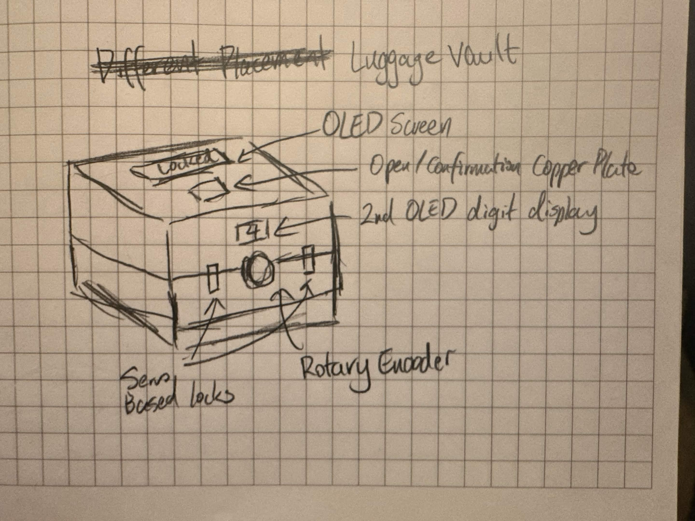

**Design Rationale:** I used a familiar luggage form so the lid and front locks suggest where the vault opens. The second OLED displays the selected digit beside the rotary encoder, while the top screen and copper plate group lock status with confirmation; this separates the two tasks, although it may require looking between surfaces. However, this seems redundant with there being easier ways to open a chest.

#### D2. Cylinder Vault

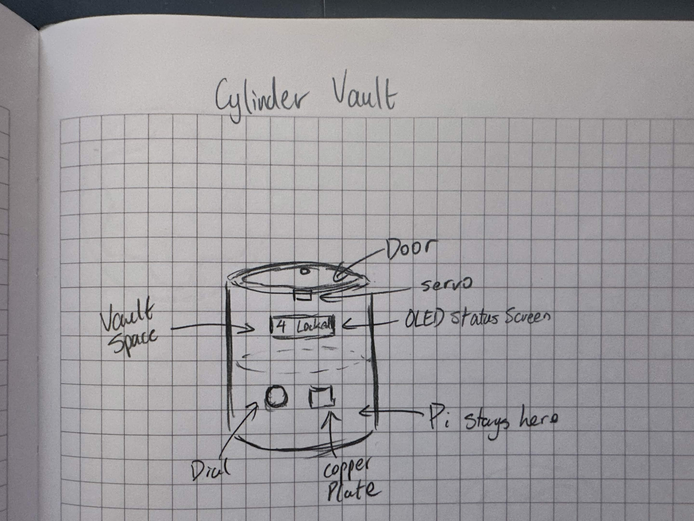

**Design Rationale:** I grouped the OLED, dial and copper plate on the front of the cylinder so the selected digit and lock status can be read while entering the code. The sketch reserves the lower area for the Pi and places the storage opening at the top, separating access to the contents from the control area. However, to ensure the sensors, servo, display stay properly on the cynclinder shape, a lot of small adjustments might be overwhelming to design for, when more traditional designs are more user friendly. 

#### D3. Shelf Vault

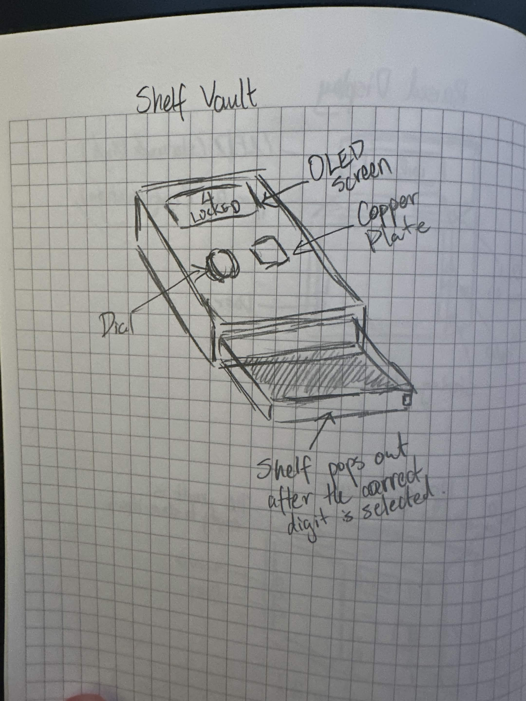

**Design Rationale:** I angled the OLED, dial and copper plate toward someone using the vault on a table, keeping the feedback and controls together in one view. The shelf popping out after a correct combination would make acceptance visible through physical movement and bring the stored item toward the user. This could be an interesting discreet vault. 

#### D4. Upright Vault

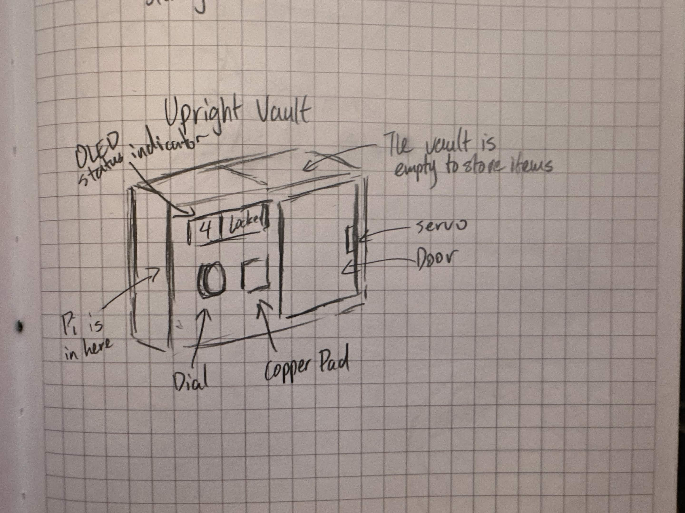

**Design Rationale:** I placed the OLED above the dial and copper pad on a fixed control section, making the turn–confirm–check sequence easy to follow without reaching across the door. The servo acts as a latch release. Keeping the Pi behind this section leaves the adjacent compartment available for stored items and lets the door move independently of the controls. This is the most similar to what an actual vault looks like, with the controller/keypad right beside the vault door, which might enhance user recall on the interaction techniques. 

#### D5. Raised Display

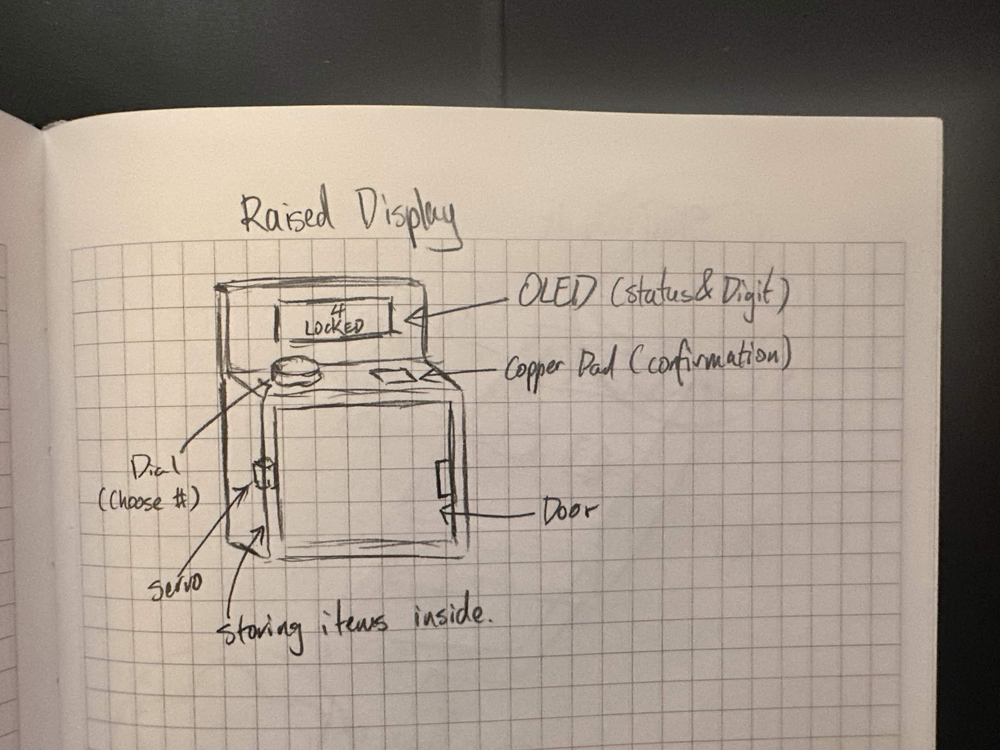

**Design Rationale:** I raised the OLED behind the dial and copper pad so the selected digit and lock status remain visible above the hand during entry. The low control deck separates turning and touching from the front storage door, giving each action its own physical area. The servo still acts as a latch release. However, I realized that when the user interacts with the rotary encoder and copper plate correctly, the door might swing open and hit the user's hands, which could cause an inconvenience. 

#### Written Reflection

***What are some things these raise as questions? What do you need to physically prototype to understand how to answer those questions?***

These sketches make me question whether the arrangement clearly shows what to turn, what to touch and where to look for the result. Can I read the OLED while using the dial, and is there enough space to move to the copper pad without confirming accidentally? The Luggage Vault also raises the question of whether two displays help or divide attention, while the top lid, pop-out shelf and swinging doors each need different clearance around the housing.

I would use cardboard forms with movable screen and control positions to compare viewing angles, hand clearance and stability at a normal tabletop distance. I would also fit the actual Pi and cables, leave access for maintenance, and test the proposed opening separately with a lightweight lid, shelf or door before integrating it; a convincing shape alone would not show that the servo can move it reliably.

#### Pick one display design to integrate into the prototype

***Explain the rationale for the design.***

I chose the **Upright Vault** because its familiar safe-like form connects entering a combination with opening the adjacent door, and the display above the controls keeps the selected digit and lock status in the same area as the input. The fixed control section also gives the Pi a separate place without taking over the storage compartment, making this a straightforward arrangement to explore in cardboard.

#### Cardboard Prototype

I built the **Upright Vault** in cardboard and tape, with a fixed control panel beside a separate storage door. The panel has a cardboard display marked “4 | Locked,” a raised cardboard dial, and a copper pad to represent the turn–confirm–check interaction.

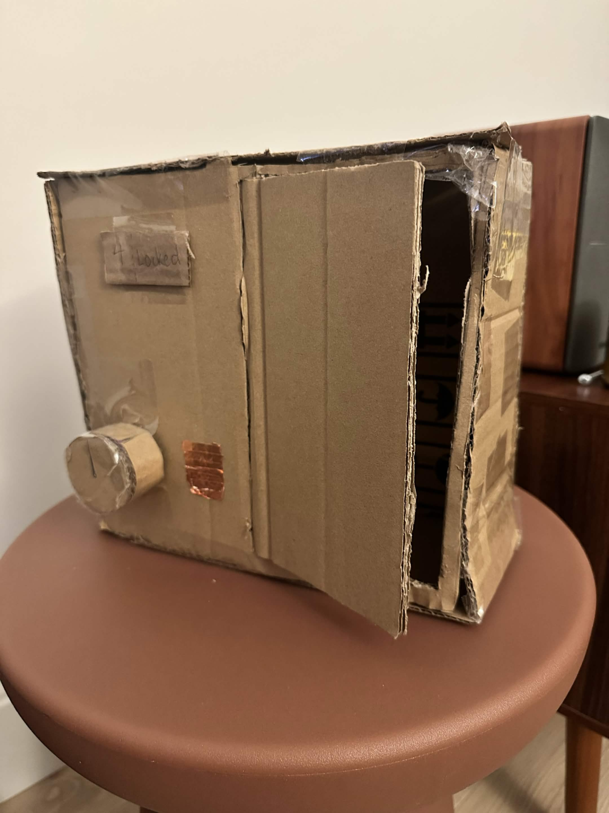

*Front view: the display, dial and copper pad are grouped on the fixed left panel, beside the opening storage door.*

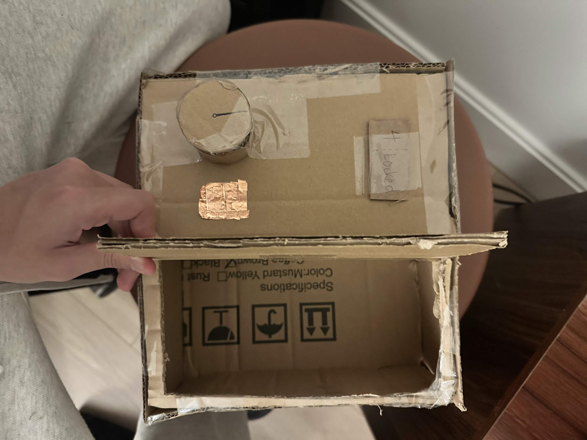

*Open-compartment view: the door opens separately from the control panel, exposing the storage space.*


## Part 2 (Week 2)

### E. Multi-device demo

**Code:** [vault.py](vault.py) · [requirements](requirements-vault.txt) · [how to run it](docs/setup.md)

The vault combines two inputs and four outputs. I turn the rotary encoder to choose a digit and press the Qwiic Button to enter it. The Mini PiTFT shows the digit I am on, the OLED shows LOCKED, OPEN or DENIED, the servo turns when the code is correct, and the light on the encoder changes colour with the lock state. The code is `314`.

**Why a button instead of the copper pad:** my Part C and D sketches and the cardboard prototype used a copper pad to confirm each digit. I switched to a SparkFun Qwiic Button because a button press is a stronger confirmation than a copper pad or copper tape. 

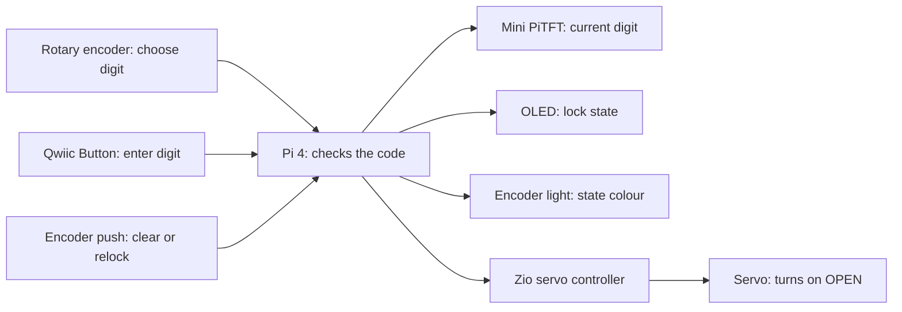

#### Setup

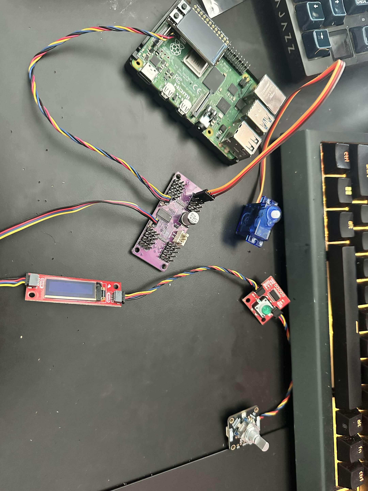

Everything except the servo's power runs on one chain of Qwiic cables: Mini PiTFT on the Pi → Zio servo controller → OLED → Qwiic Button → rotary encoder. The Mini PiTFT sits directly on the Pi's header.

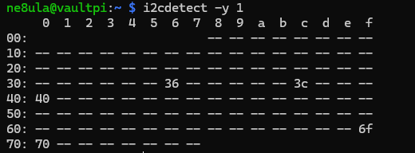

`i2cdetect -y 1` found every board on the chain:

| Address | Board |
|---|---|
| 0x36 | Rotary encoder |
| 0x3C | OLED |
| 0x40 | Zio servo controller (0x70 is the same chip's second address) |
| 0x6F | Qwiic Button |

#### How I connected the servo

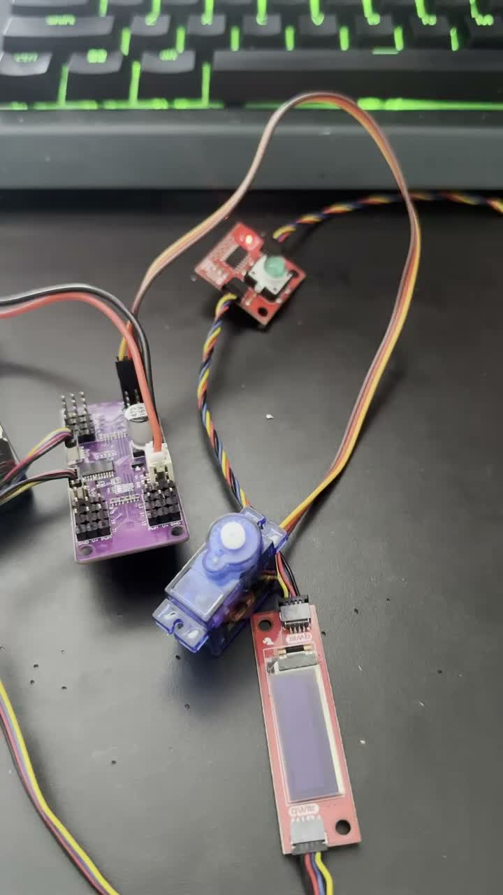

The servo needs two connections to the Zio.

- **Signal:** the servo's three-wire plug goes on the Zio's channel 0 header. The header pins are labelled PWM, V+ and GND, so the orange wire sits on PWM, red on V+ and brown on GND.
- **Power:** the Qwiic cable only carries 3.3 V for the chips, which is not enough to move a servo. I used a separate 5 V supply. Its barrel plug goes into a barrel-jack adapter with two screw terminals, and a two-wire JST lead runs from those terminals to the white two-pin socket on the Zio marked V+ and GND. The wire colours on my lead were the opposite of what I expected, so the black wire is the one that ends up on V+. I checked this with a multimeter before plugging the lead into the Zio.

The Pi tells the Zio what angle to hold over the Qwiic cable, and the Zio sends the signal and the 5 V to the servo.

#### First test without the servo

```bash
python vault.py --no-servo --encoder qt
```

<a href="evidence/e-demo/no-servo-demo.mp4">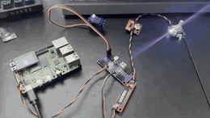</a>

Video: [entering 3-1-4 with the encoder and button](evidence/e-demo/no-servo-demo.mp4).

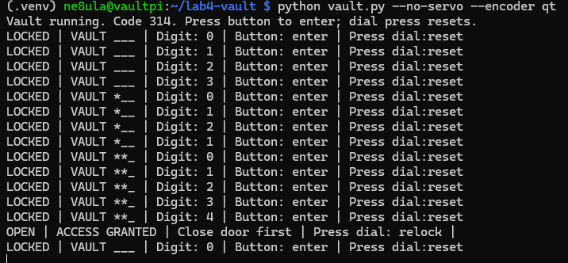

Each turn of the encoder changed the digit on the TFT, and each button press added a star and reset the digit to 0. After 3, 1 and 4 both screens changed to OPEN, and pressing the encoder locked it again.

#### Adding the servo

```bash
python -u vault.py --encoder qt --locked-angle 60 --open-angle 120
```

<a href="evidence/e-demo/servo-demo.mp4">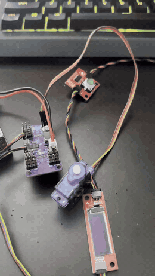</a>

Video: [servo connected to the Zio](evidence/e-demo/servo-demo.mp4).

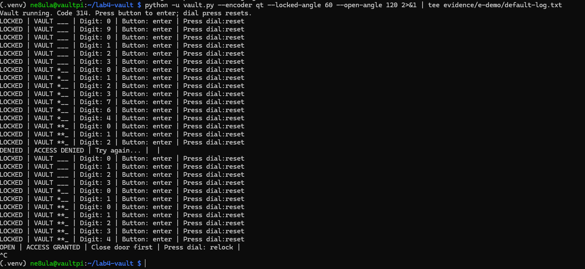

In this run I first entered 3-4-2, which showed DENIED and reset after about a second and a half. Then I entered 3-1-4 and the vault opened.

#### Final video

<a href="evidence/e-demo/final-demo.mp4">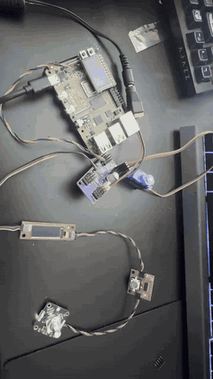</a>

Video: [full run with both inputs, both screens and the servo](evidence/e-demo/final-demo.mp4). The preview plays at 2x speed.

How the vault behaves:

1. It starts locked on digit 0.
2. Turning the encoder changes the digit from 0 to 9. Pressing the button enters it.
3. After `314`, both screens show OPEN and the servo turns from 60° to 120°.
4. A wrong code shows DENIED for about a second and a half, then starts over.
5. Pressing the encoder clears a half-entered code, or locks the vault again after it opens.
6. Holding the button down only counts once.

#### Written reflection

***What did you learn about multi-input/multi-output interaction? What was fun, surprising, or challenging?***

I learned that most of the work in a multi-input, multi-output device is in the connections between the parts. Each board worked quickly when I tested it alone, but getting them to work together meant understanding how they were wired and powered.

The most challenging part was the servo. I had to understand why it needs its own 5 V supply, and how a turning servo could work as a lock and unlock mechanism. The power lead was another difficult issue: the black wire ended up being the positive one, and I had to check it with a multimeter before I trusted it.

I was surprised by how friendly the interface felt and how fast it responds. Once I understood how the different physical controls connect, everything felt quite intuitive.

The fun part was piecing different interaction techniques together. I was almost disappointed with the scope of my vault once I figured out more combinations I could have used. That is also why I chose another sensor instead of copper tape. Even though the vault only takes three digits of a pre-coded password, seeing the code, the interaction and the wiring all come together physically was very rewarding.

***What new types of interaction become possible when you combine two or more sensors or actuators?***

Combining the encoder with a separate button splits entering a code into two clear actions: turn to choose a digit, then press to confirm it. With only the encoder, the user has to press the same control they are turning. When I tested the encoder with two participants who are beginners with hardware, neither of them knew it could be pressed down. A green button is something people already recognise as a confirm button, so I used it for that.

On the output side, the two screens and the servo let the vault show the digit being chosen, the lock state and a physical movement at the same time.

***How does the physical arrangement of devices (e.g., where the encoder or sensor is placed) change the user experience?***

The two screens were close together, so I could see both while entering the code without looking away from my hands for long.

The encoder was harder to use. Without a knob, the bare shaft is difficult to turn one digit at a time, and I often landed on the wrong digit. My next step is to 3D print a knob so single-digit turns are easier.

***What happens if you use one device to control or modulate another (e.g., encoder sets a threshold, sensor triggers an action)?***

In my vault the encoder sets the digit, the button enters it, and the entered code decides what the screens show and whether the servo moves. The encoder never opens anything by itself. It only changes what the button is about to submit.

The chain felt instant, which was very rewarding. The TFT, the OLED and the servo all updated at almost exactly the same time.

***How does the system feel if you swap which device is "primary" and which is "secondary"?***

I only tested the vault one way: the encoder as the primary control for choosing digits and the button as the secondary control for confirming. I did not try it the other way round.

Based on my two participants, I expect that making the encoder press the confirm action would feel worse. They did not know the encoder could be pressed, while the green button was obvious to them.

### F. Final documentation

**Code:** [vault.py](vault.py), run with:

```bash
python -u vault.py --encoder qt --reverse-servo --locked-angle 50 --open-angle 150
```

<a href="evidence/f-final/final-demo.mp4">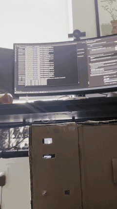</a>

Video: [entering the code, opening the door and locking it again](evidence/f-final/final-demo.mp4). The preview plays at 2x speed.

#### Looks like

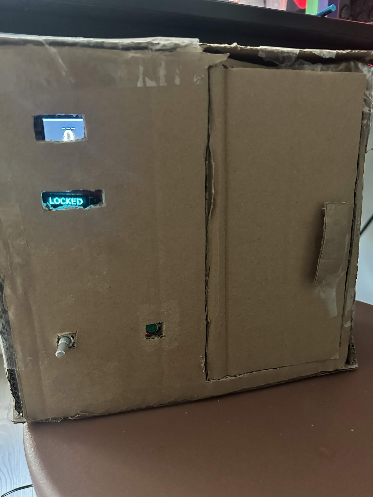

The final vault is the Upright Vault from Part D, built from cardboard and tape. The left side is a fixed control panel with four cut-outs: the Mini PiTFT at the top, the OLED below it, and the rotary encoder and green Qwiic Button side by side at the bottom. The right side is the storage door with a cardboard pull tab. Nothing is 3D printed. I kept it in cardboard so I could cut and move the openings while fitting the real parts.

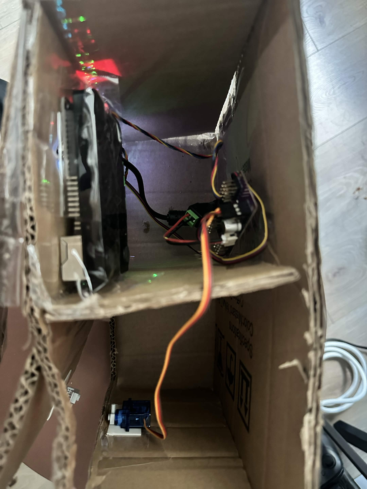

Inside, the Pi sits behind the front panel so the Mini PiTFT lines up with its cut-out. The Zio servo controller and its 5 V power adapter sit on a cardboard shelf, and the servo lead runs down to the servo beside the door.

#### Works like

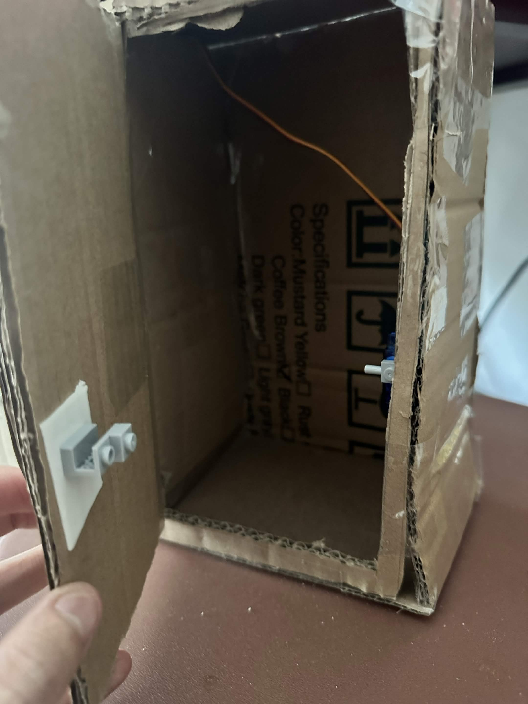

The Pi reads the encoder and the button, checks the code, and updates both screens and the servo. The servo is the lock. I built the locking mechanism from LEGO bricks: one LEGO piece is attached to the servo and turns with it, and another is taped to the inside of the door. When the vault is locked, the servo turns its piece behind the one on the door so the door cannot be pulled open. When the code is correct, the servo turns it out of the way.

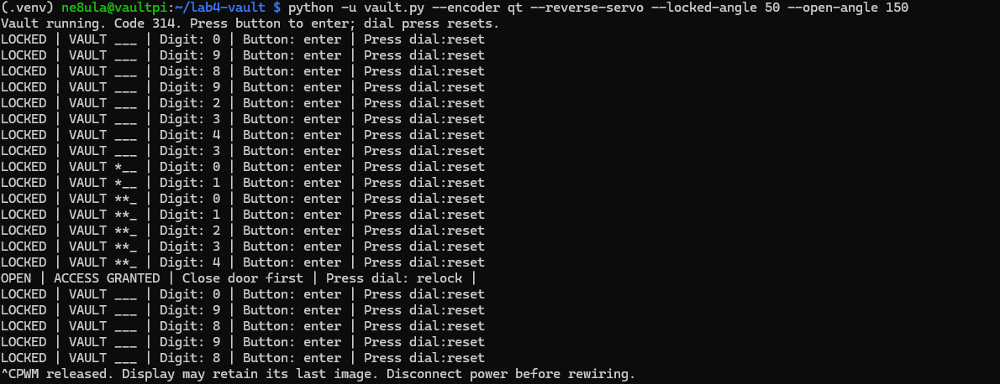

The log from the final run shows 3, 1 and 4 being entered, the vault opening, and the vault locking again after I pressed the encoder.

#### Acts like

1. The vault starts locked. The TFT shows the current digit and the OLED shows LOCKED.
2. I turn the encoder to a digit and press the green button to enter it. A star appears on the TFT for each digit entered.
3. After 3, 1 and 4, both screens show OPEN and the servo unlocks the door.
4. I pull the door open by its tab, then close it again.
5. I press the encoder and the vault locks. A wrong code shows DENIED and starts over.

#### Iterations

| Version | What I had | What I changed and why |
|---|---|---|
| Cardboard mock-up (Part D) | Cardboard box with a paper display, a cardboard dial and a copper pad | It showed that the screen-above-controls layout and the separate door made sense before any electronics went in. |
| Bench test (Part E) | All the boards working on the desk | I replaced the copper pad with the Qwiic Button, and made the digit on the TFT larger with the extra text removed so it is readable through a small cut-out. |
| Servo angles, first try | Locked 60, open 120 | The servo was not turning enough to move the latch. The code was only using about half of the servo's range, so I changed it to use the full 0 to 180. |
| Servo direction | Full range | The servo turned the opposite way from what the latch needed, so I added a `--reverse-servo` option. |
| Servo angles, final | Many single-angle tests | I tried one angle at a time until the LEGO piece fully blocked the door and fully cleared it. This landed at locked 50 and open 150. |
| Final vault | Everything installed in the cardboard body | LEGO latch on the servo and door, cut-outs for both screens, the encoder and the button. |

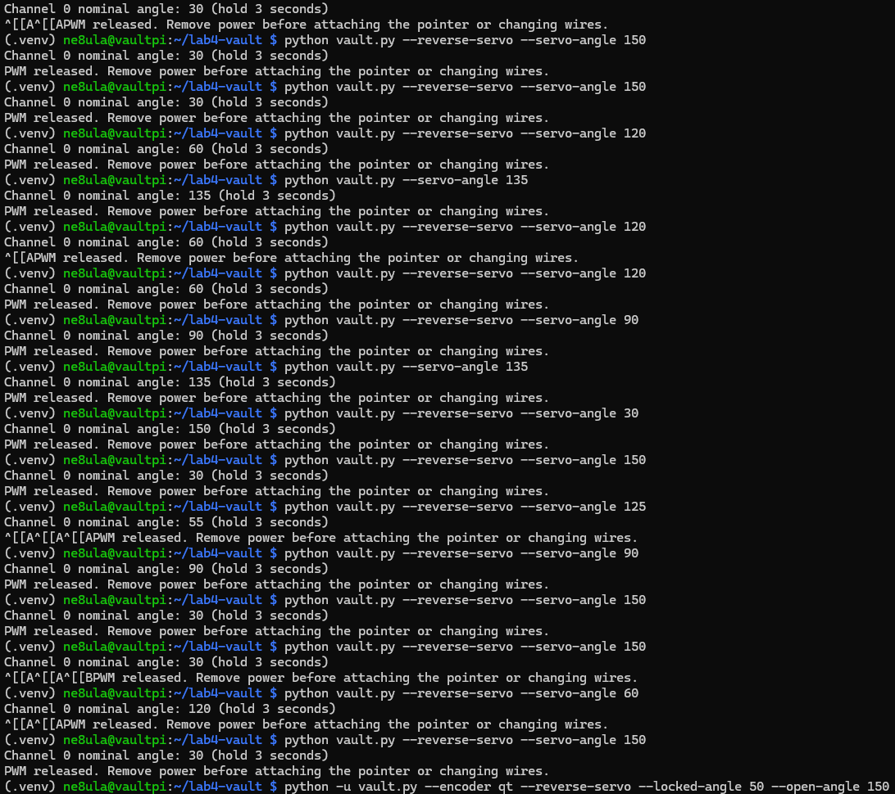

The servo angles took the most trial and error. The screenshot above shows part of it: I ran the single-angle test again and again at 150, 120, 135, 90, 30, 125 and 60, with and without the reverse option, and watched where the latch ended up each time before settling on 50 and 150.

#### What I learned and next steps

The software side came together faster than the physical side. Getting the code to open on 314 took one test. Getting a servo to hold a cardboard door shut took many, because the right angles depend on exactly where the servo and the LEGO pieces are mounted, and that can only be found by trying it.

Next steps:

- 3D print the locking mechanism so the latch is a proper fitted part and not LEGO and tape.
- 3D print a knob for the encoder, since the bare shaft is hard to turn one digit at a time.

#### AI Usage
I used AI (ChatGPT and Claude) to format the .md which was originally documented in Google Docs (due to easier table creations, and technical diagram creations). I also used it for assistance during coding tasks (mostly debugging). Hardware, evidence, written reflection, design, and everything else was done by me. 