# Lab 5: Observant Systems

**Author:** Hao Chen Xiong

## Part A

### A1. PyTorch / MobileNet

**Experiment:** I ran the course's unchanged `infer.py` on a Raspberry Pi 4, viewed its output through SSH, and held the USB webcam toward six objects in sequence: a small ceramic teapot, a computer mouse, a simple wooden Santa figure, a mug, a candle in a white container, and a complex Gundam/Batman figure.

**Configuration and code:** I used the provided infer.py script without changing it. It uses MobileNet v2 to classify the webcam image and prints its top two predictions for each frame.

All **425 frames** in the saved log have shape `(144, 176, 3)`: the camera actually supplied **176 × 144 pixels**, not the requested square resolution. The first two FPS reports were **0.67** and **2.75**; the remaining 52 reports ranged from **6.03–7.40 FPS**, with a median of **7.24 FPS**. These are the script's periodic processing-loop throughput readings, including capture, preprocessing, inference, and printing. They are not the camera's hardware FPS or an isolated inference benchmark.

| Object / observation | Result and interpretation |
|---|---|
| Ceramic teapot | The early sequence produced `teapot`, including a 94.59% top score; alternatives included `coffeepot` and `cup`. |
| Computer mouse |The following sequence produced `mouse, computer mouse`, reaching a 99.88% top score. This was a clear example of a familiar category being recognized. |
| Wooden Santa |Predictions were unstable and did not identify Santa; the corresponding part of the log includes `lipstick` and `Christmas stocking`.  |
| Mug |The mug sequence included `cup` and `coffee mug`. Their highest top scores in the run were 89.28% and 64.36%, respectively. |
| Candle in a white container |A `candle` label appeared briefly in the log, but the object was mistaken as cups, and many other random items. |
| Gundam/Batman figure | The figure sequence produced unrelated labels including `aircraft carrier` and `syringe`; the terminal still below shows a 64.68% `aircraft carrier` score. |

Note: Object transitions, hands, and the background (although I ensured the background was as unobtrusive as possible), were also part of the captured scene.

**What failed and why:** Both the simple Santa and the complex figure were misclassified. This demonstrates a limitation of the recognition system. The supplied [class list](https://github.com/IRL-CT/Interactive-Lab-Hub/blob/9ef02d4ead28bafc0a803116a6a952f3908b7463/Lab%205/classes.json) has no Santa, Gundam, or Batman, or anything related for its category, so the model cannot directly output those identities. A candle container can resemble a cup because of varying viewpoint and low captured resolution are plausible additional contributors, but this experiment did not isolate their effects. Frame-by-frame classification explains why the displayed labels can switch rapidly.

**Evidence:** [Object demonstration (51 s)](evidence/a1/objects.mp4) | [Download MP4](evidence/a1/objects.mp4?raw=true) | [Terminal recording (63 s, silent)](evidence/a1/terminal.mp4) | [Download MP4](evidence/a1/terminal.mp4?raw=true) | [Text log](evidence/a1/a1-final-20261109-122444-WnQoJV.txt)

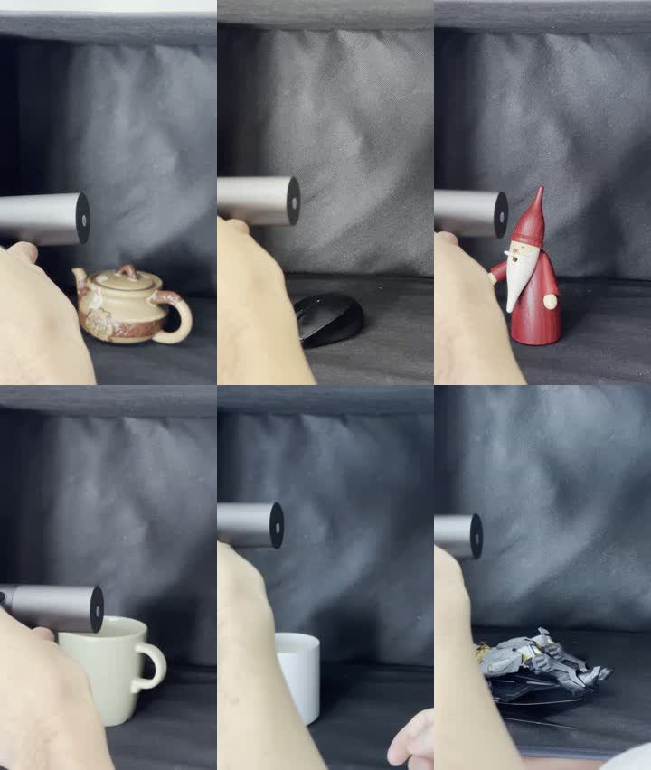

Phone-video stills at 00:01, 00:07, 00:14, 00:21, 00:30, and 00:44

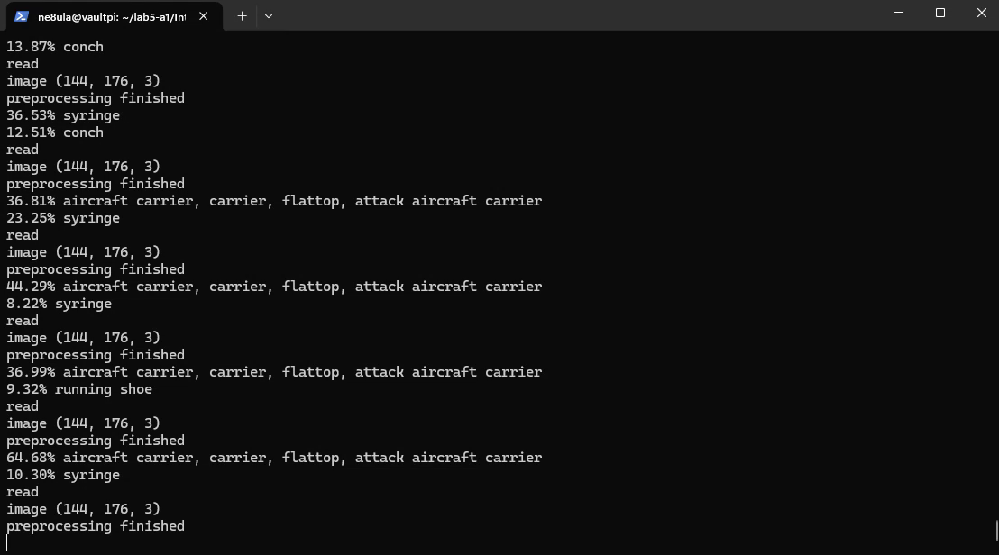

### A2. MediaPipe

I ran `hand_pose.py` on the Pi and tested hand tracking, pinch control, Quiet Coyote, and recovery. The dots followed my fingers, and opening or closing the gap between my thumb and index finger changed the percentage and audio volume.

I also moved my hand toward and away from the camera while trying to keep the same finger gap. The volume still changed: the display went from **14% at 0:45 to 91% at 0:49**. The script measures the gap in image pixels, so moving closer makes it look bigger; it doesn't account for depth.

Quiet Coyote silenced the audio and showed **0% at 1:00**. When I rotated my hand sideways, the dots overlapped and the gesture stopped registering, even though my hand was still tracked. By **1:05**, the display showed **18%** and the audio had resumed. Rotation changes the distances the gesture rule checks. I then returned to pinch control and could adjust the volume again.

For the prototype in future parts, I could use a gesture to pause reminders and a pinch to set the pause length. After this test, I'd keep the pause active until a clear resume action, so turning my hand wouldn't accidentally restart reminders.

**Evidence:** [Full demo with audio (1:49)](evidence/a2/hand-tracking.mp4) ? [Download MP4](evidence/a2/hand-tracking.mp4?raw=true).

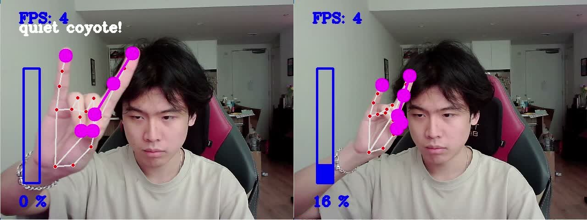

*Left: Quiet Coyote recognized. Right: recognition drops during rotation, while hand tracking continues.*

### A3. Moondream

I ran Moondream through Ollama on the Pi in CPU-only mode, using `moondream_simple.py` with a separate timing wrapper. I arranged a mug, a ceramic teapot, and a computer mouse in front of the webcam against a dark background. The script captured one image, then used that same image for all three questions.

The first question, **“What do you see in this image? Describe it.”**, took **237.971 seconds**, almost four minutes. Moondream identified a teapot and a computer mouse, described the teapot as pink with a floral design, and said they were on a wooden table. When I asked **“What objects are visible in this image?”**, it again named the teapot and mouse and took **27.407 seconds**. Neither answer mentioned the mug visible in my setup photo. The pink teapot and wooden surface descriptions also don't match that photo, although the photo shows the setup from a different viewpoint than the webcam.

I then asked **“Which object has a handle and a spout?”** It answered **“urn”** in **3.628 seconds**. This was the wrong identification for my teapot, even though the earlier descriptions called it a teapot. The script sends each question independently, so it doesn't carry the earlier answers into the next request. The answers were inconsistent across questions; I didn't isolate why.

These are times from sending each request through printing its completed answer, including image encoding, but excluding camera capture and my typing. This was a rerun with different questions and answer lengths, so the timing difference doesn't establish how much time model loading took.

For Shelf Watcher, a response arriving almost four minutes after capture could describe a scene that has already changed. I'd use this kind of description for an occasional desk summary, with a visible processing state and capture time. For timely reminders, I'd continue testing the smaller custom classifier planned for the next part. The quick but incorrect “urn” answer also shows why speed alone isn't enough to judge whether the response is useful.

**Evidence:** My setup photo and all three terminal screenshots are shown below, including the full questions, answers, and timings.

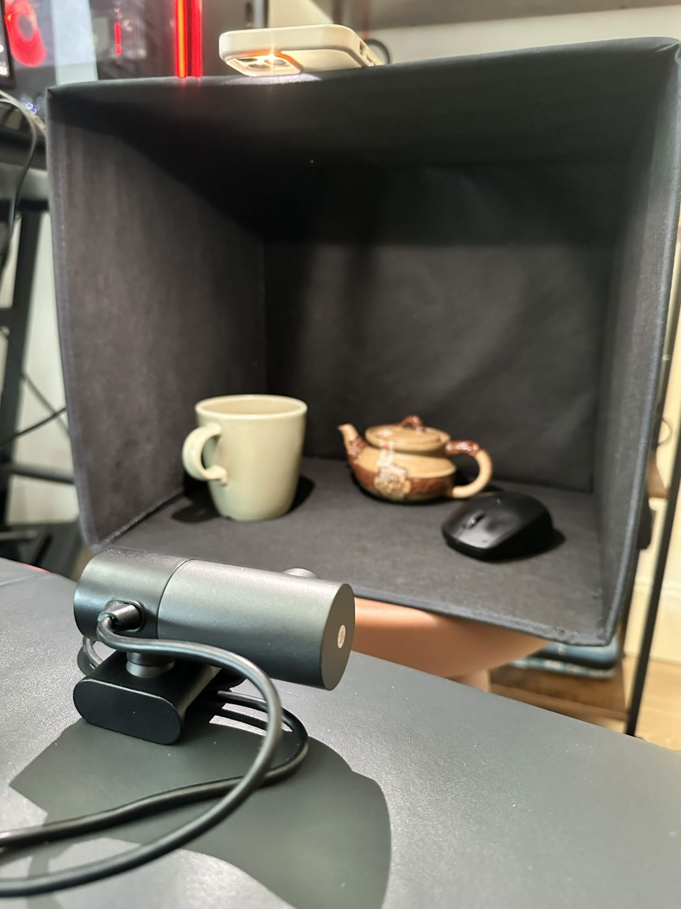

*My physical setup. This is an external photo, not the webcam's captured input image.*

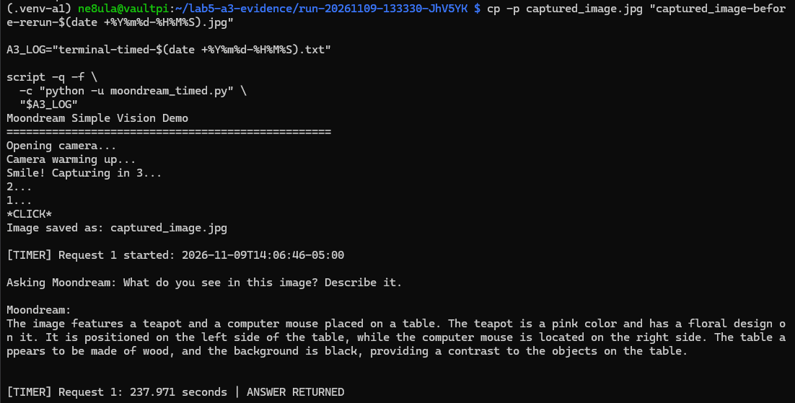

*Request 1: the initial description takes almost four minutes.*

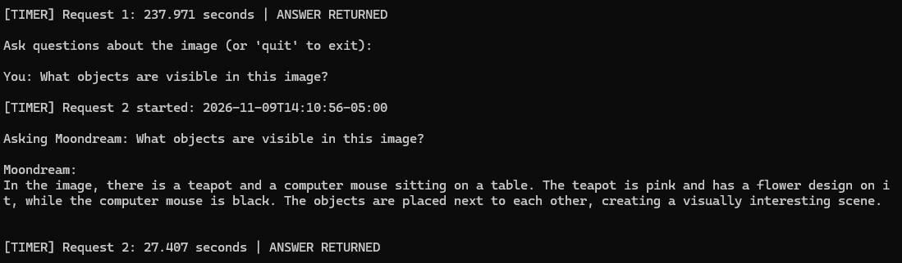

*Request 2: the object list again leaves out the mug visible in the setup photo.*

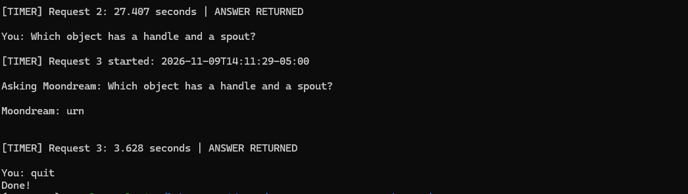

*Request 3: a faster answer, but the wrong identification for the teapot.*

### A4. Teachable Machine

I ran `tml_example.py`, then trained a Standard image model to recognize **WORK, VIDEO, and NEUTRAL**. My first model used Kiyo recordings but misclassified the Pi camera view. I retrained using the Pi webcam at its shelf position: **184 WORK, 163 VIDEO, and 200 NEUTRAL images**, including desktop and blank-screen examples.

I checked all three classes in Teachable Machine's file preview, exported a quantized TensorFlow Lite model and `labels.txt`, and ran them on the Pi.

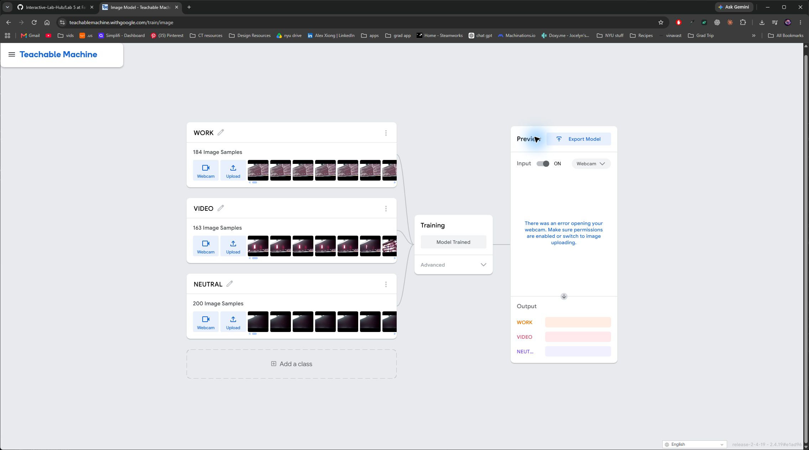

[Training screenshots](evidence/a4/pi-training-v2) | [Model](models/a4-pi-v2/model.tflite) | [Labels](models/a4-pi-v2/labels.txt).

I recorded a three-minute test while switching between work, video, and neutral scenes. **826/872 labeled frames were correct (94.7%)**, excluding 25 ambiguous transitions. Bright fullscreen video sometimes became WORK, and a different wallpaper became VIDEO. This result covers one short recording with correlated frames.

**Evidence:** [Pi webcam video (silent)](evidence/a4/manual-20261110-163239/camera-review.mp4) ? [Download MP4](evidence/a4/manual-20261110-163239/camera-review.mp4?raw=true) | [Timestamped predictions](evidence/a4/manual-20261110-163239/predictions.csv) | [Results](evidence/a4/manual-20261110-163239/summary.json) | [Reviewed labels](evidence/a4/manual-20261110-163239/annotations.csv) | [Per-frame scores](evidence/a4/manual-20261110-163239/scored-predictions.csv).

| WORK preview | VIDEO preview | NEUTRAL preview |
|---|---|---|
| 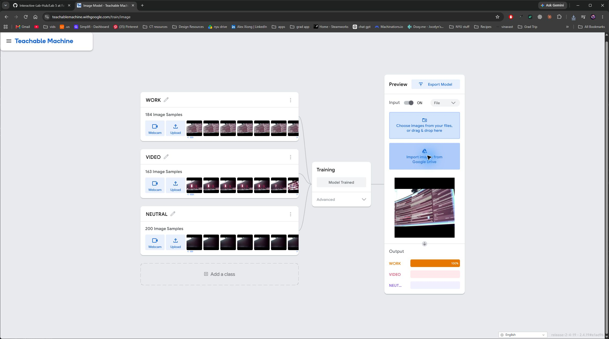 | 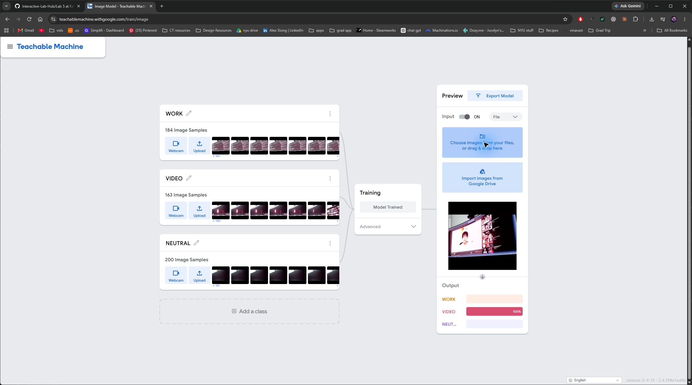 | 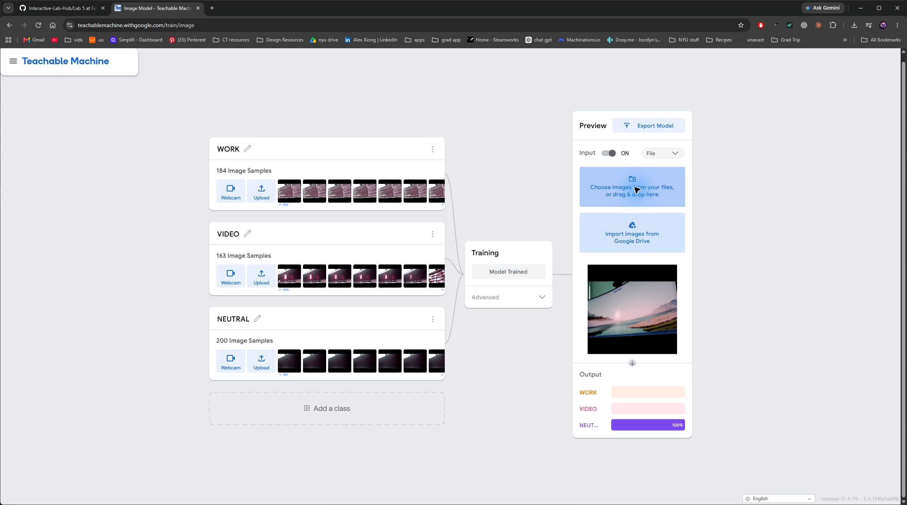 |

[Quantized export screenshot](evidence/a4/pi-training-v2/export-quantized.png) | [Stock example](evidence/a4/stock-example-vnc.png) | [First training attempt](evidence/a4/training-complete-camera-unavailable.png) | [Baseline model](models/a4-kiyo-v1/model.tflite) | [Pi results](evidence/a4/pi-training-v2/pi-vnc-results.png) | [Dataset counts](evidence/a4/pi-training-v2/dataset-summary.json).

| Scene | Correct / labeled frames |
|---|---:|
| WORK | 472 / 474 |
| VIDEO | 333 / 362 |
| NEUTRAL | 21 / 36 |

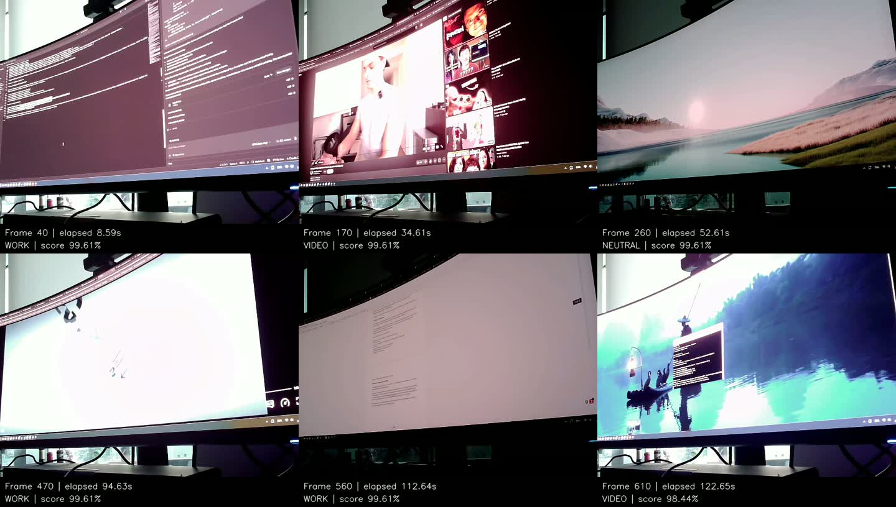

I'd use this classifier for Shelf Watcher to recognize screen appearances and trigger a reminder after sustained VIDEO detection. A video can still be work, so the interaction would need a user override.

Teachable Machine lets me define categories through examples instead of writing visual rules. OpenCV provides capture and image-processing tools; MediaPipe provides landmarks for position-based gestures and continuous controls. Teachable Machine fits my custom scene categories, but depends on representative training examples.

## Part B: Shelf Watcher interaction

My Shelf Watcher uses a Pi webcam to look at my monitor and classify what it sees
as WORK, VIDEO, or NEUTRAL. Its miniTFT face looks happy when I'm working, angry
when it detects video, and asleep when the screen is neutral. If VIDEO stays
detected for 15 seconds, it plays a spoken reminder through my Leviathan V2
speaker, with at least 15 seconds between reminders. Returning to work or neutral
resets the video timer.

I tested it by switching between an editor, video playback, and my desktop.
First I tried triple beeps after five seconds with no cooldown. Then I switched
to three spoken clips that play in order and increased the trigger and cooldown
to 15 seconds. I preferred the spoken clips. Finally, I added the faces so the
current prediction is visible between reminders. I recorded phone videos and
checked the Pi logs to see which faces and reminders were triggered.

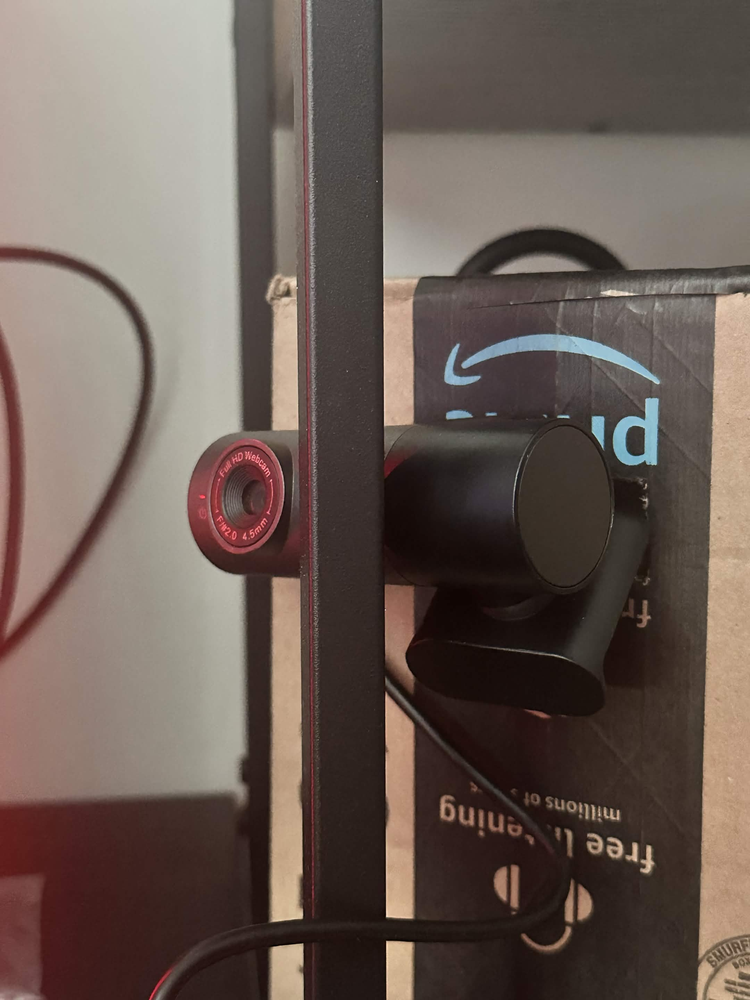

*My webcam setup for observing the monitor.*

| Experiment | Output | VIDEO trigger / cooldown | Result |
|---|---|---|---|
| 1 | Triple beeps | 5 s / 0 s | Worked as intended; 10 clips completed, then I stopped during another. |
| 2 | Three spoken clips in order | 15 s / 15 s | All three clips completed in order. I preferred the spoken clips. |
| 3 | Spoken clips plus miniTFT faces | 15 s / 15 s | Happy WORK, angry VIDEO, asleep NEUTRAL; all three faces confirmed, two reminders completed. |

Below 85% confidence, the face looks puzzled and the VIDEO timer resets.
Audio clips never overlap. Since I changed both sound and timing, the beep/voice
comparison covers the full configurations.

**Evidence:** [Beep demonstration with audio](evidence/b1/beep-demo.mp4) | [Download MP4](evidence/b1/beep-demo.mp4?raw=true) |
[Voice demonstration with audio](evidence/b1/voice-demo.mp4) | [Download MP4](evidence/b1/voice-demo.mp4?raw=true) |
[Voice + display demonstration](evidence/b1/display-demo.mp4) | [Download MP4](evidence/b1/display-demo.mp4?raw=true) |
[Run results](evidence/b1/run-summary.json).

| WORK: happy | VIDEO: angry | NEUTRAL: asleep |
|---|---|---|
| 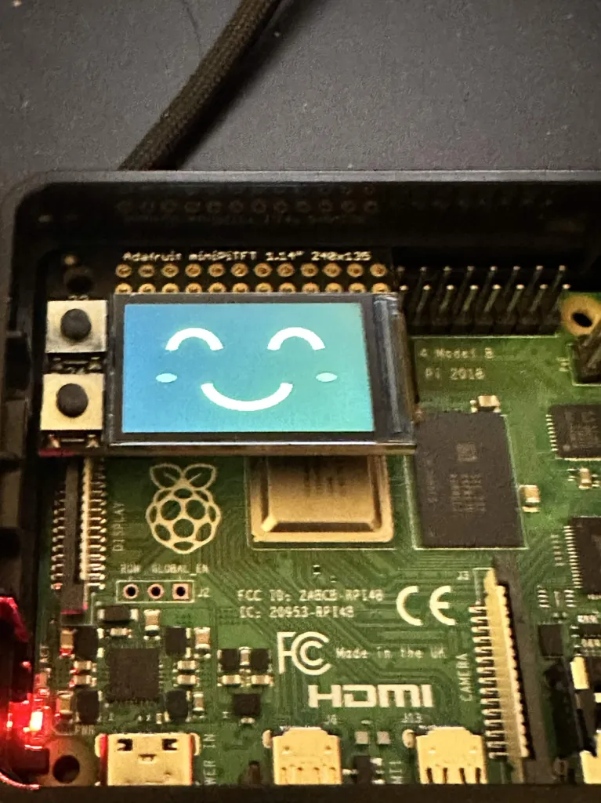 | 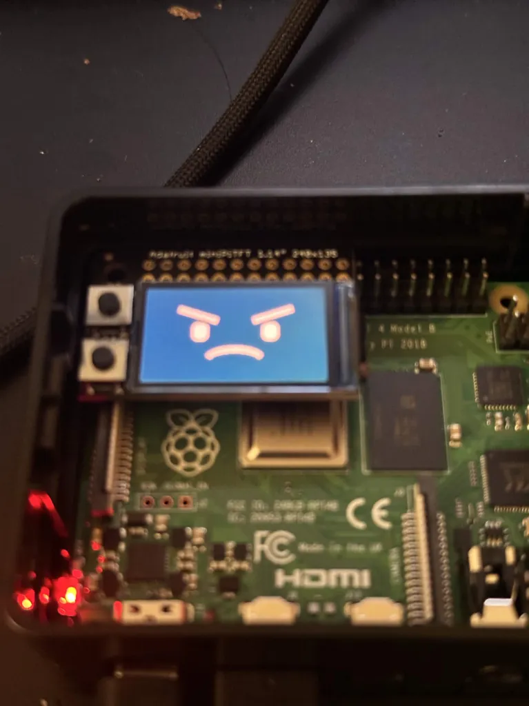 | 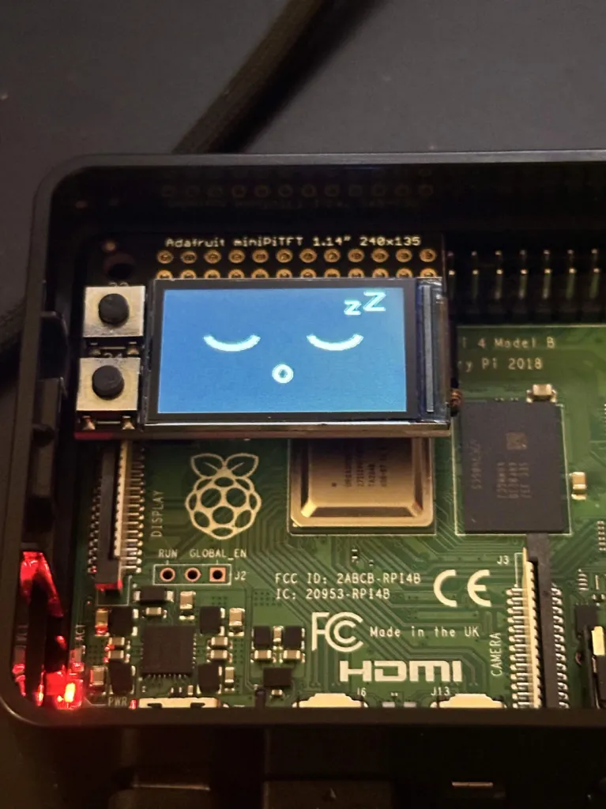 |

[Display setup and exact commands](docs/part-b-display.md) |
[Application code](scripts/b1_shelf_watcher.py).

| Experiment logs | Predictions | Events | Settings |
|---|---|---|---|
| Beep | [CSV](evidence/b1/beep-run/predictions.csv) | [JSONL](evidence/b1/beep-run/events.jsonl) | [JSON](evidence/b1/beep-run/metadata.json) |
| Voice | [CSV](evidence/b1/voice-run/predictions.csv) | [JSONL](evidence/b1/voice-run/events.jsonl) | [JSON](evidence/b1/voice-run/metadata.json) |
| Voice + display | [CSV](evidence/b1/display-run/predictions.csv) | [JSONL](evidence/b1/display-run/events.jsonl) | [JSON](evidence/b1/display-run/metadata.json) |

The logs verify controller timing and non-overlapping playback against its predictions; they do not measure classifier accuracy. Phone videos and Pi logs use separate clocks. The beep run stopped during its eleventh clip and has one final camera frame without a matching CSV row.

## Part C: Flight test

I based this reflection on the [Experiment 3 face-and-voice video](evidence/b1/display-demo.mp4) | [Download MP4](evidence/b1/display-demo.mp4?raw=true), its [logs and results](evidence/b1/run-summary.json), and the earlier [beep demonstration](evidence/b1/beep-demo.mp4) | [Download MP4](evidence/b1/beep-demo.mp4?raw=true). I also used my own experience and informal feedback from two participants. The [two follow-up videos in Part D](#part-d--reflect-characterize-the-system) show the split-screen and lighting problems described below.

**1. When does it do what it is supposed to do?**

In Experiment 3, the miniTFT showed happy, angry, and asleep faces for WORK, VIDEO, and NEUTRAL. I could see what it thought was on screen between reminders. It played two spoken reminders at 25.08 and 40.29 seconds on the Pi's recording clock, matching the 15-second wait and 15-second gap I had set. It also responded quickly when I switched between the work pages and video sites I tested.

**2. When does it fail?**

The exposed Pi and screen felt unfinished, and the separate Bluetooth speaker made it hard to tell where the voice was coming from. I found the repeated reminders irritating, and both participants felt the same way. I also found two recognition problems: putting an editor beside a video made it show WORK in my test, and turning off the room lights made its reactions keep changing.

**3. When it fails, why does it fail?**

The face and speaker were physically separate, so they did not feel like one character. The repeated reminders also made it feel like a jail warden telling me what to do. I think the recognition problems came partly from gaps in my training examples. I had left out split-screen layouts and different room lighting. The webcam's resolution could also play a part. I would need to test those factors separately to understand how much each one matters.

**4. Based on the behavior you have seen, what other scenarios could cause problems?**

It could interrupt a tutorial I am watching for work because it judges what the screen looks like. In a shared room, the reminders could distract other people. Over time, I might start ignoring or muting them. I would also expect glare, a moved camera, or something partly covering the lens to cause problems. Those situations still need testing.

**5. Are users aware of the uncertainties in the system?**

The face looks puzzled when the model's score falls below 85%. I am unsure whether the participants understood that expression. Across the three trials, a user noticed one classification mistake. People seemed to notice the sound first. Those trials used a well-lit room and one application filling the screen, so I still need to check how people respond during split-screen use.

**6. How badly would users be impacted by a misclassification?**

A mistaken VIDEO result could interrupt someone's work and make them feel unfairly corrected. Missing a video could mean they never get a reminder. The beep experiment worked without an observed error. I expected the beeps to bring people back to work quickly, like an alarm clock, but I did not time that. Both participants preferred the spoken reminder, even with its mistakes.

**7. How could you change the interactive system to address this?**

I would give it a mascot body and put the speaker near the face so it feels like the character is speaking. I would also try gentler expressions, encouraging reminders, and a positive response when I return to work. A pause button, a way to mark a video as work, and an adjustable reminder interval would let me decide when it should interrupt.

**8. Are there optimizations you can try on the sense-making algorithm?**

I could make it wait for several similar predictions before changing the face, which might reduce the rapid switching. I could also crop the camera image to the monitor and add training examples with different layouts and lighting. I would try one change at a time on scenes kept out of training, then count mistaken reminders and missed videos and measure how long it takes to respond. Waiting for more predictions could also make it slower.

## Part D: Reflect

I tested Shelf Watcher again in a [normal walkthrough (2:42)](evidence/d1/normal-walkthrough.mp4) | [Download MP4](evidence/d1/normal-walkthrough.mp4?raw=true) and a [room-lights-off test (0:28)](evidence/d1/no-room-lighting.mp4) | [Download MP4](evidence/d1/no-room-lighting.mp4?raw=true), explaining what I saw as I recorded. My comments about how it feels also come from the experience and feedback in Part C.

**1. What can you use it for?**

I can use it to remind me when I switch from work to a video site. In the walkthrough, it shows WORK for my editor, ElevenLabs, and Google Docs, and VIDEO for several streaming sites. It judges the screen's appearance, so a tutorial I need for work could also trigger a reminder.

**2. What is a good environment for it?**

It worked well at my normally lit desk, with the webcam fixed toward the monitor and one application taking up most of the screen. The work pages showed a happy face. Netflix, Disney+, HBO Max, Prime Video, and Bilibili showed an angry face during the walkthrough. I tested a small selection of pages on each site.

**3. What is a bad environment for it?**

Sharing the screen between an editor and a video caused problems. The editor made it treat the screen as WORK even with video visible. Turning off the room lights also caused trouble: the face kept changing while I stayed on one video platform. Glare and different camera positions still need testing.

**4. When will it break?**

At **2:10–2:42 in the walkthrough**, I put an editor in front of or beside the video. By **2:38**, the face is happy while video content remains on screen. In the **lights-off clip**, Bilibili stays on screen while the face changes. I think adding training examples for these layouts and lighting conditions could help. I would need separate tests to check the effects of the training data, webcam exposure, and resolution.

**5. When it breaks, how will it break?**

It can show a happy face while missing the video, as it does in the split-screen test. With the room lights off, it shows an angry face at **0:14** and a happy face at **0:16**, with puzzled faces at other points. WORK and low-confidence predictions reset the VIDEO timer, which could delay or prevent a reminder. I did not count missed reminders in these recordings.

**6. What are its other properties or behaviors?**

Streaming-site menus can trigger VIDEO even before a video starts playing. At **1:32–1:41**, I also point out a brief confused reaction to Prime Video before it returns to VIDEO. The face responds quickly, and the spoken reminder waits for sustained VIDEO detection. In Part B, I set a 15-second wait before speaking and at least 15 seconds between reminders. A score below 85% shows the puzzled face and resets the timer. I used those earlier settings and tests to describe the timing here.

**7. How does it feel?**

The faces make its reactions easy to see. Seeing it smile while missing a video makes me trust it less. The repeated reminders irritated me and both participants, as I described in Part C. The exposed hardware and separate speaker also made it feel unfinished. I would like to give it a body, soften the reminders, and add controls to pause it or mark a video as work. Those changes are still on my to-do list.

**Video evidence:** [Normal walkthrough with narration](evidence/d1/normal-walkthrough.mp4) | [Download MP4](evidence/d1/normal-walkthrough.mp4?raw=true) | [No room lighting with narration](evidence/d1/no-room-lighting.mp4) | [Download MP4](evidence/d1/no-room-lighting.mp4?raw=true).

| Video page, 1:00 | Split-screen failure, 2:38 |
|---|---|
| 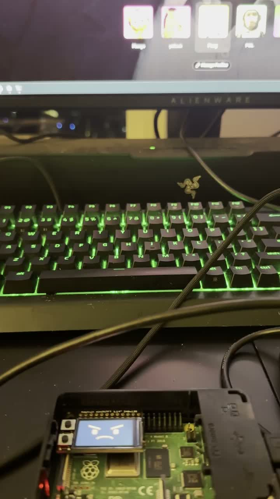 | 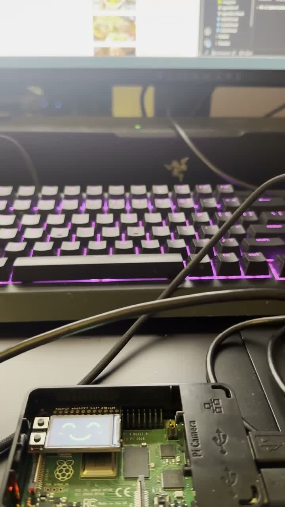 |

| Lights off, 0:14 | Lights off, 0:16 | Lights off, 0:26 |
|---|---|---|
| 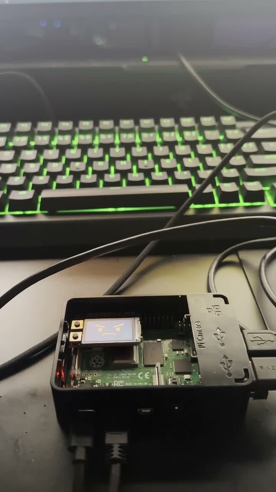 | 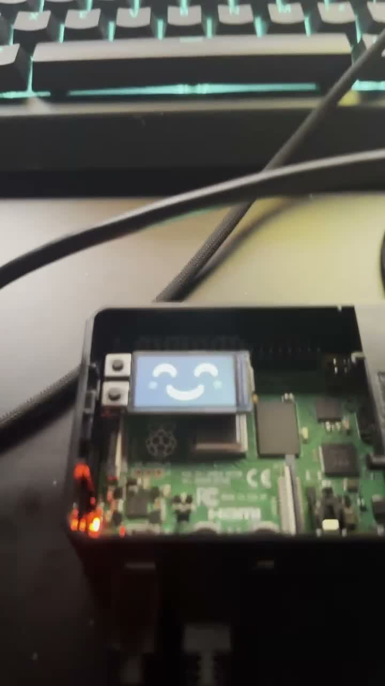 | 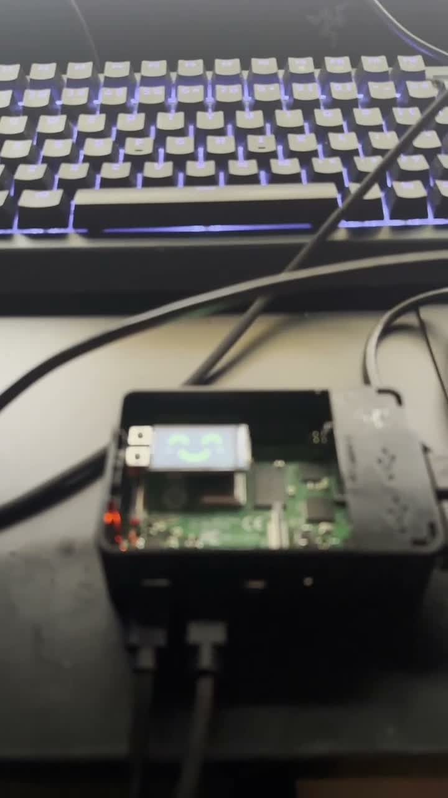 |

## Part 2: Finished system in use

**[Companion in Use](evidence/part2/finished-companion.mp4) | [Download MP4](evidence/part2/finished-companion.mp4?raw=true).**

I finished Shelf Watcher by giving it a cardboard body and attaching the expression display to the front. In the earlier trials, participants did not really notice the expression until they heard the audio cue. I wanted the face to belong to the companion, making it feel more like a character reacting to me. This was my reason for anthropomorphizing the enclosure.

The webcam still observes my physical monitor. The classifier drives the miniTFT expressions and spoken reminders. The final run's saved settings confirm a **10-second sustained VIDEO trigger**, an **85% confidence threshold**, and a **7-second cooldown**. These are shorter timings than the 15-second trigger and cooldown in Part B. The cooldown is measured between reminder starts, and clips cannot overlap. WORK, NEUTRAL, or a low-confidence prediction resets the VIDEO timer.

In the video, I start on my work screen, switch to video content, and return to work near the end. The enclosed companion stays beside the monitor, and the recording captures the spoken reminders during video use.

The [final run logs](evidence/part2/final-run) contain **568 frames** and **five completed reminders** in the order 01, 02, 03, 01, 02. The first reminder started after 10.005 seconds of qualifying VIDEO predictions; later reminders started about 7.20 seconds apart, without overlapping. When the prediction returned to WORK, no new reminders started, but the clip already playing finished. The log also records happy, angry, asleep, and uncertain display states.

| Front: face and camera | Side: cable opening | Rear/side: enclosure interior |
|---|---|---|
| 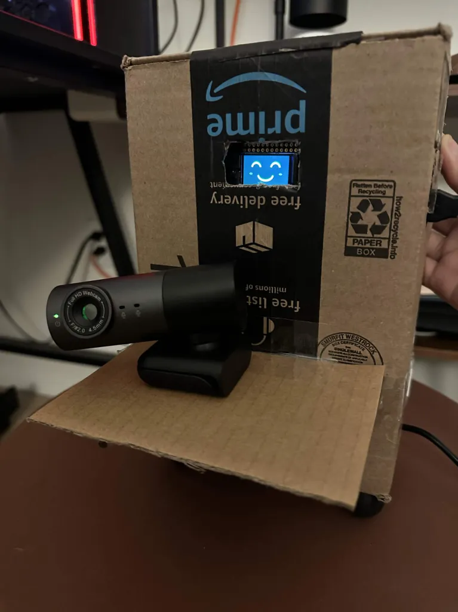 | 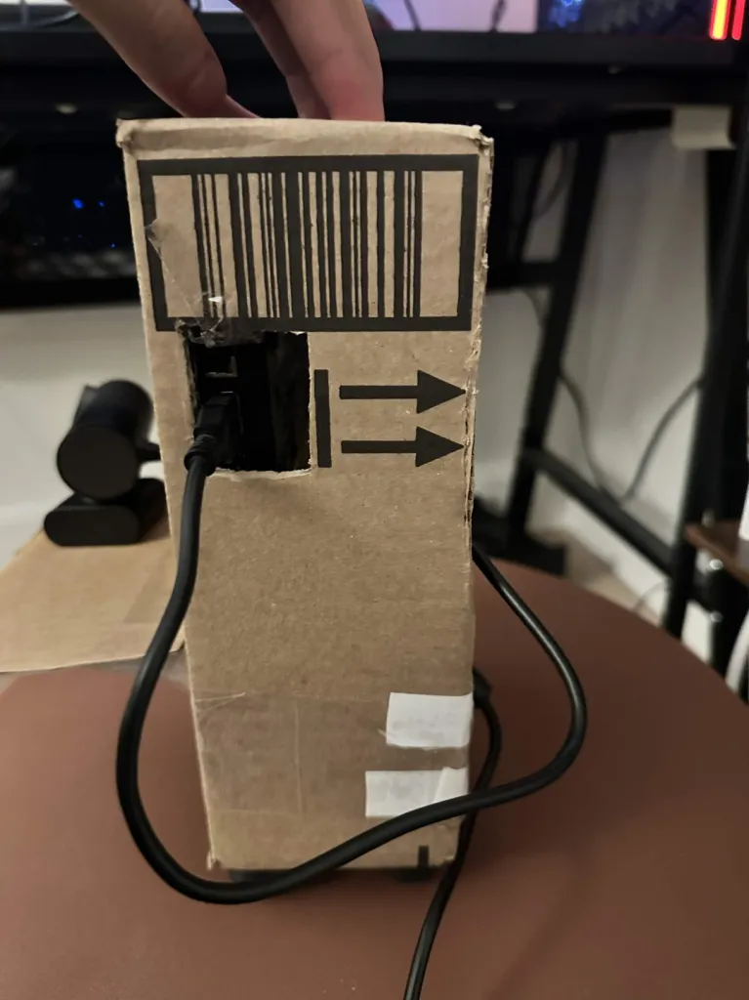 | 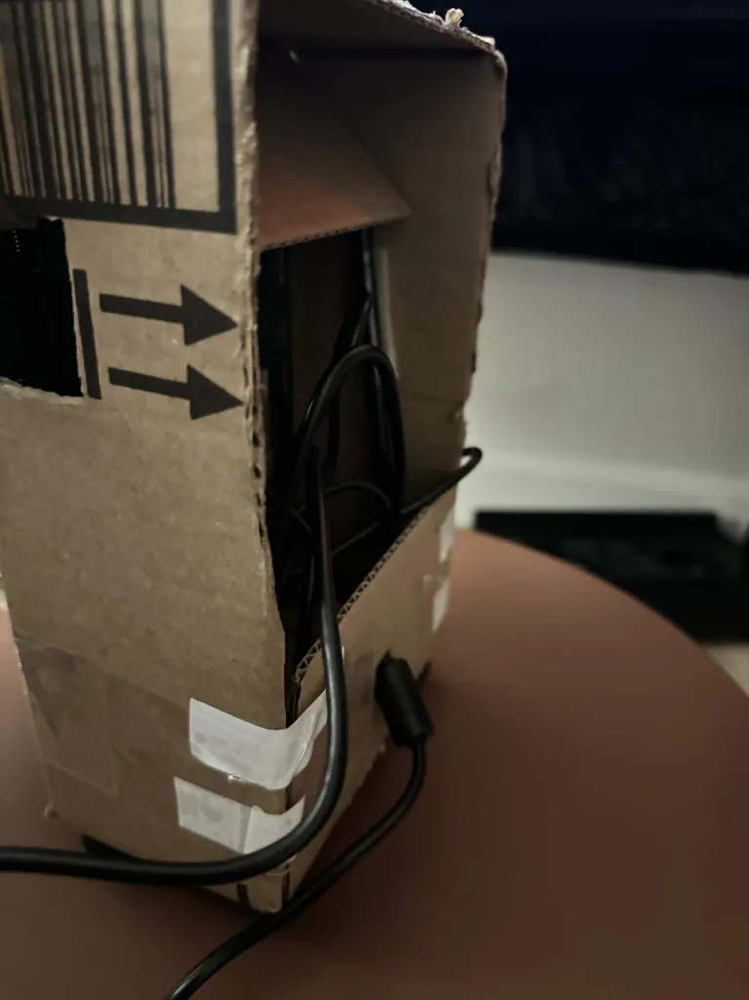 |

*Photos of the finished build.*

The enclosure gives the expression a physical character to belong to, but it does not solve the classifier's limitations. Split-screen layouts and lighting changes caused problems in Part D, and a work-related tutorial can still look like VIDEO. The speaker is still separate. A pause control, a way to mark a video as work, and another participant test would be useful next steps.

The phone video shows work at 0:00–0:20, video use and spoken reminders at 0:20–1:03, and a return to work at 1:03–1:28. The Pi run lasted 113.69 seconds; its timestamps are separate from the phone video.

**Final run:** [Predictions](evidence/part2/final-run/predictions.csv) | [Events](evidence/part2/final-run/events.jsonl) | [Settings](evidence/part2/final-run/metadata.json) | [Run checks](evidence/part2/run-summary.json) | [Enclosure in use at 1:10](evidence/part2/enclosure-70s.jpg) | [Launch command](docs/part2-run.md).

### AI Usage*
 used AI (ChatGPT and Claude) to format the .md which was originally documented in Google Docs (due to easier table creations, and technical diagram creations). IDue to this lab's required video documentation,   used AI to figure out how to properly embed all different sized videos onto the .md rather than uploading it all to YouTube. Ialso used it for assistance during coding tasks (mostly debugging). Hardware, evidence, written reflection, design, and everything else was done by me.