# Lab 6: Shared Garden

**Lab 6: Distributed Interaction · Fall2025**
**Author:** Hao Chen Xiong

## Deliverables

- [Part A: MQTT messaging and screenshots](#part-a-mqtt-messaging)
- [Part B: pixel grid, photos and video](#part-b-collaborative-pixel-grid) | [Course starter code](part-b-starter/) | [Button publisher](part_b_buttons.py)
- [Part C: Shared Garden, architecture, build and source code](#part-c-shared-garden)
- Videos: [Full garden run](evidence/garden-run.mp4) | [Mulch station](evidence/pi-mulch.mp4) | [Sun station](evidence/pi-sun.mp4) | [Part B buttons](evidence/part-b-buttons-demo.mov)
- [User testing status](#4-user-testing) | [Reflection](#5-reflection)
- [Install and launch](docs/SETUP.md)

## Launch the prototype

From the project folder, after [installing dependencies](docs/SETUP.md):

```powershell
.\.venv\Scripts\python.exe app.py --demo
```

Open http://localhost:5000 for the automatic, offline preview. For live MQTT play, use `app.py --host 0.0.0.0` instead of `app.py --demo`; station commands are in [Setup](docs/SETUP.md).

## Lab setup

**Working alone.** The assignment asks for three people and three Pis. I'm doing it solo with one Raspberry Pi 4. I built all three sensor stations as separate prototypes on that Pi, and for playing with three people, phones stand in for the stations the Pi is not running. Every station's messages go over MQTT either way. Details are in Part C.


## Part A: MQTT messaging

I published a message from my Pi to the course broker on `IDD/test/xiong` and received it in a second session subscribed to `IDD/test/#` (2026-11-11).

Publish:

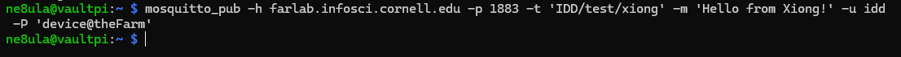

Subscribe, showing the message arriving:

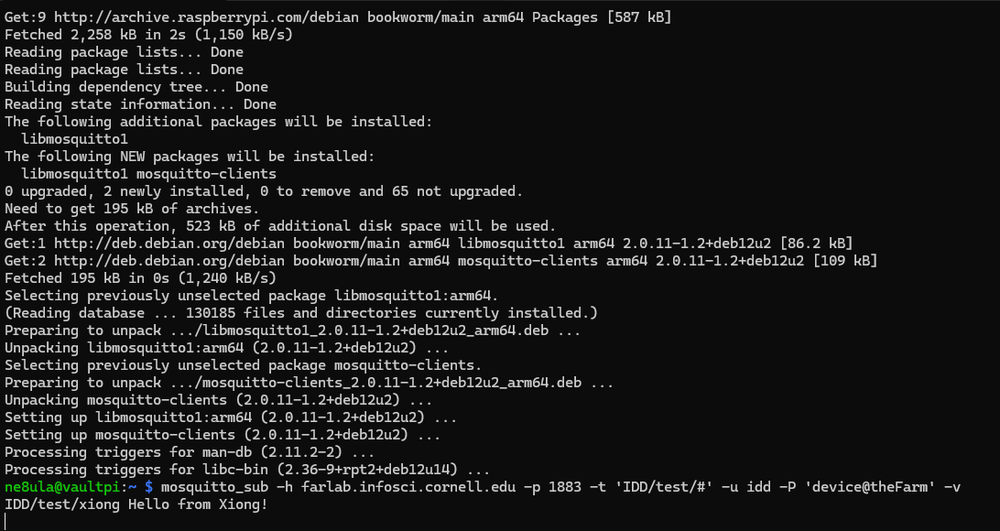

The same message in the course's MQTT viewer:

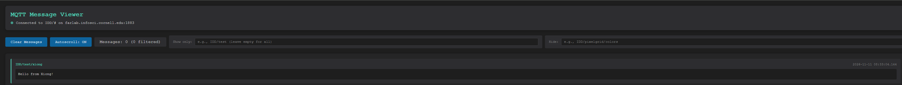

Five ideas for messaging between devices:

1. **Group mood ring:** Everybody picks a color that matches how they feel, and a big ring on a shared screen shows what you get when you mix them all together.
   Each station sends its color to `IDD/<team>/moodring/<node>/color` as something like `{"node":"pi1","rgb":[255,64,0],"quality":"ok"}`. The screen listens to all of them and averages whoever is currently there.
2. **Color lock:** Kind of like a safe that takes three people to open. Everyone has their own secret color, and the screen only unlocks when all three of you are holding the right one at the same time.
   Each station sends where its dial is to `IDD/<team>/lock/<node>/hue` as `{"hue":210}`. The lock watches all three and posts `{"open":true}` to `IDD/<team>/lock/state` when they line up.
3. **Shared garden (the one I built):** Three people look after one plant together. One waters it, one mulches it and one gives it sun. It only flowers if they take turns in the right order, and it withers if somebody jumps in early.
   The water station sends how far the can is tipped to `IDD/<team>/garden/water` as `{"tilt":60}`, the mulch station sends `{"amount":3}` to `.../garden/mulch`, and the sun station sends `{"on":true}` to `.../garden/sun`. The laptop sends whose turn it is back out on `.../garden/state`.
4. **Multiplayer instrument:** I'd split a single instrument across three stations so that one person controls the pitch, another the speed and the third the volume. You would have to actually cooperate to get a song out of it.
   The stations post to `IDD/<team>/band/pitch` (`{"note":64}`), `.../tempo` (`{"bpm":96}`) and `.../volume` (`{"level":0.6}`). A Pi with a speaker listens to `IDD/<team>/band/#` and plays the result.
5. **Story circle:** A group makes up a silly story together without typing anything. Turning the dial picks where it happens, touching a pad picks who it's about, and pressing the button throws in a plot twist. Kinda like Gartic Phone.
   Every action goes to `IDD/<team>/story/<node>/event` as something like `{"kind":"twist","value":"suddenly"}`, and a screen stitches the pieces into a sentence.

## Part B: Collaborative pixel grid

I did this part twice. I started without the APDS-9960 colour sensor, so I first made the Pi's buttons stand in for it, as I was waiting for the ADS, however, because I was still anxious about the deadline, I tried to find a workaround before the deadline. The sensor arrived later and I redid the part the way the course wrote it.

Two things are the same in both runs:

- **No teammates.** I'm doing this lab alone with one Pi, so the other two pixels come from the course's controller page open in two browser tabs.
- **Grid server on my laptop.** The hosted grid was not responding, so I ran the course's `app.py` locally.

### Run 1: buttons in place of the sensor

The two buttons on the Mini PiTFT pick the colour, 15 degrees of hue per press. The Pi sends it to the course topic (`IDD/pixelgrid/colors`) in the same format the course publisher uses.

The grid. Green is my Pi; red and purple are the two controller tabs.

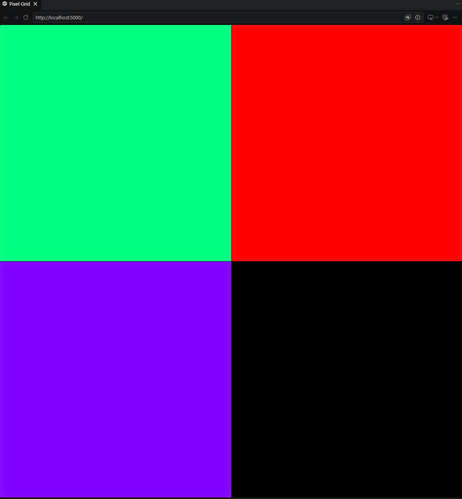

My Pi showing the colour it is sending:

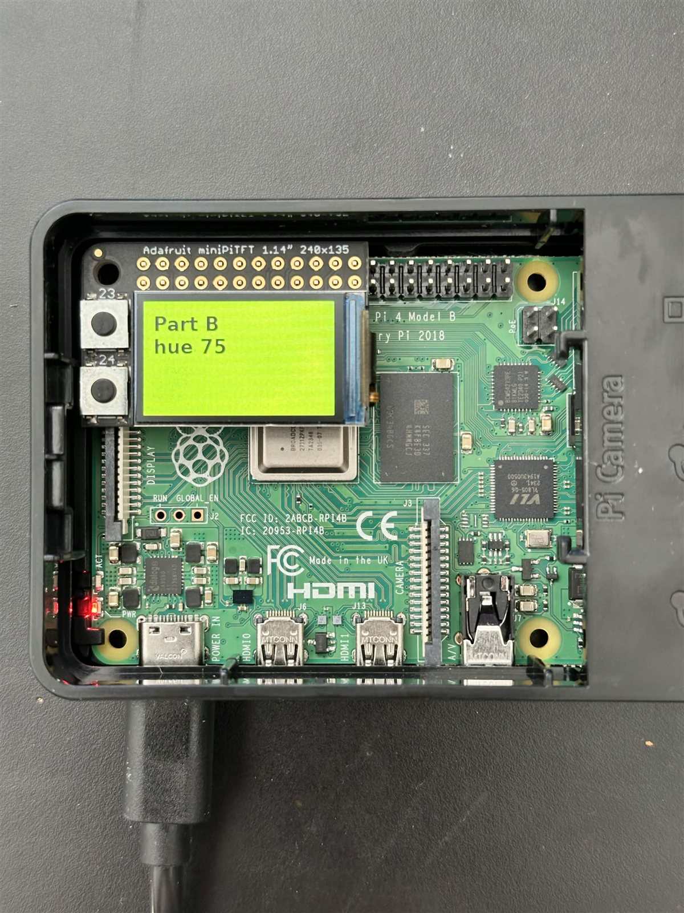

The two controller tabs, the grid, and the Pi showing the same green as its pixel:

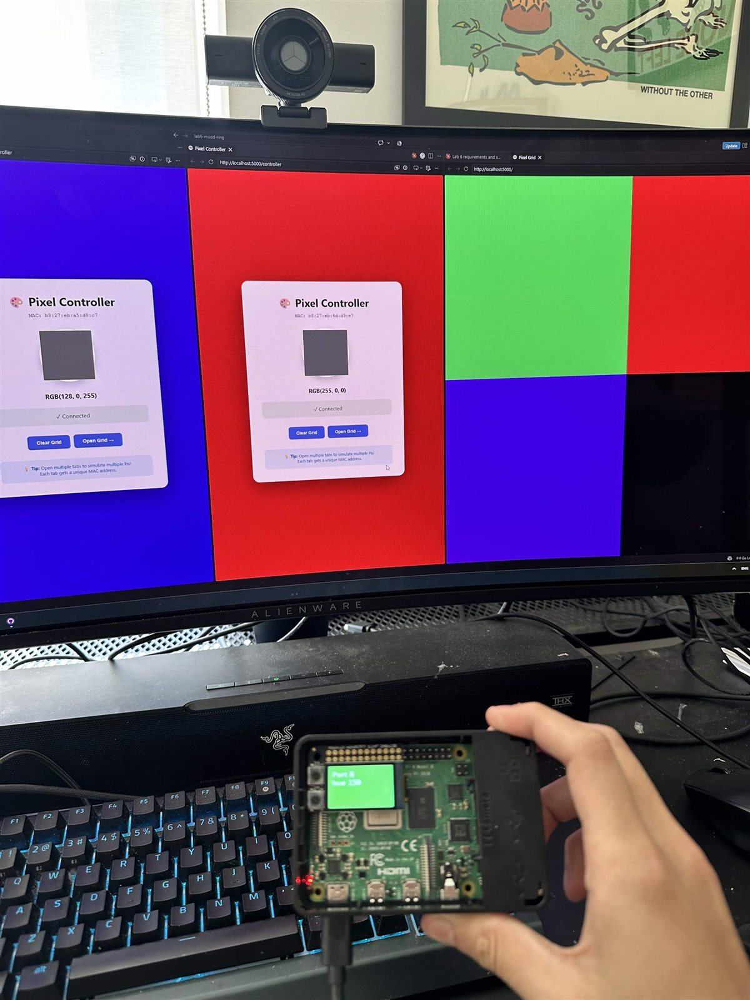

The Pi sending a new colour on every button press:

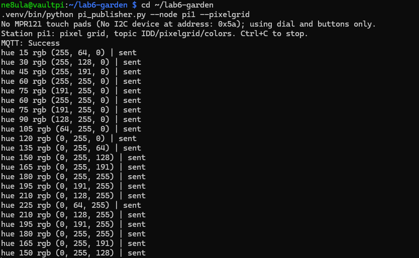

The grid server on my laptop receiving the Pi's pixel:

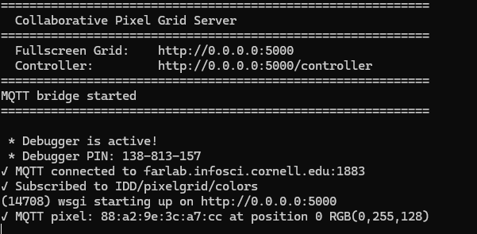

Video: [part-b-buttons-demo.mov](evidence/part-b-buttons-demo.mov)

### Run 2: with the APDS-9960 sensor

This run uses the course publisher and the real sensor.

The grid. Light blue is my Pi; orange and purple are the two controller tabs.

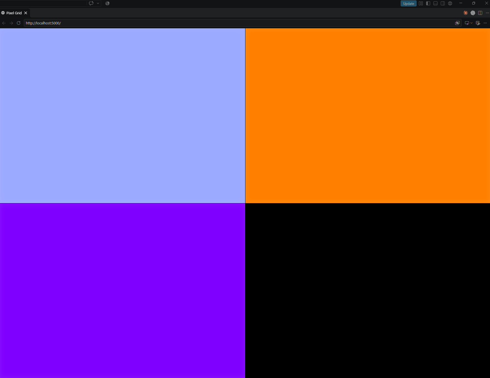

My Pi with the sensor plugged in:

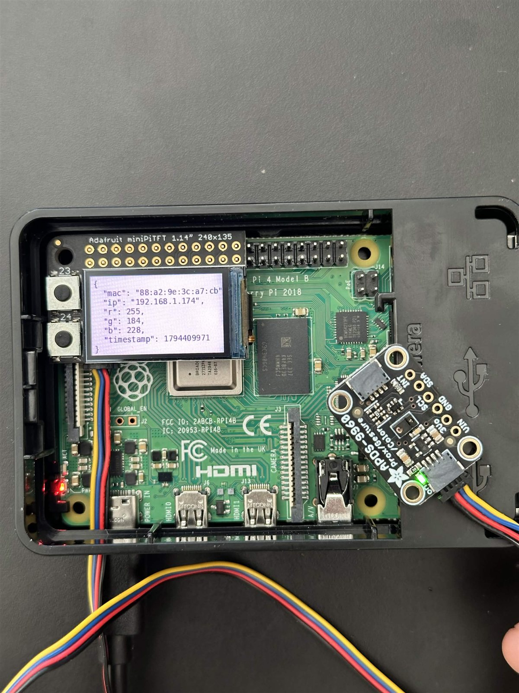

Sensor on a blue book: the Pi's screen and the grid both turn blue.

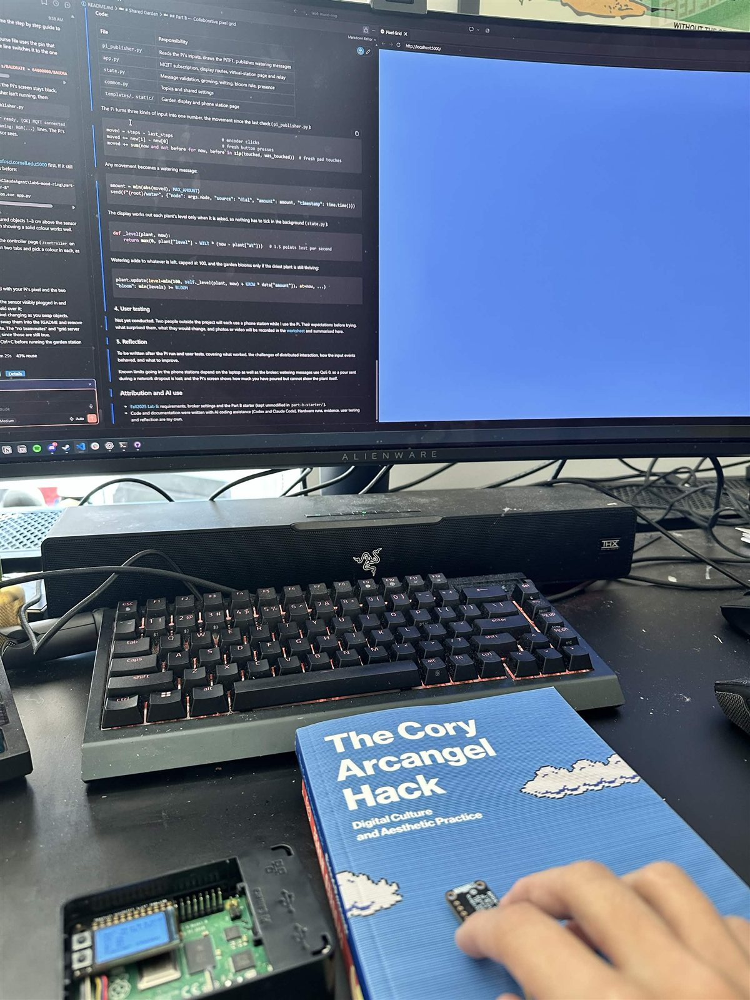
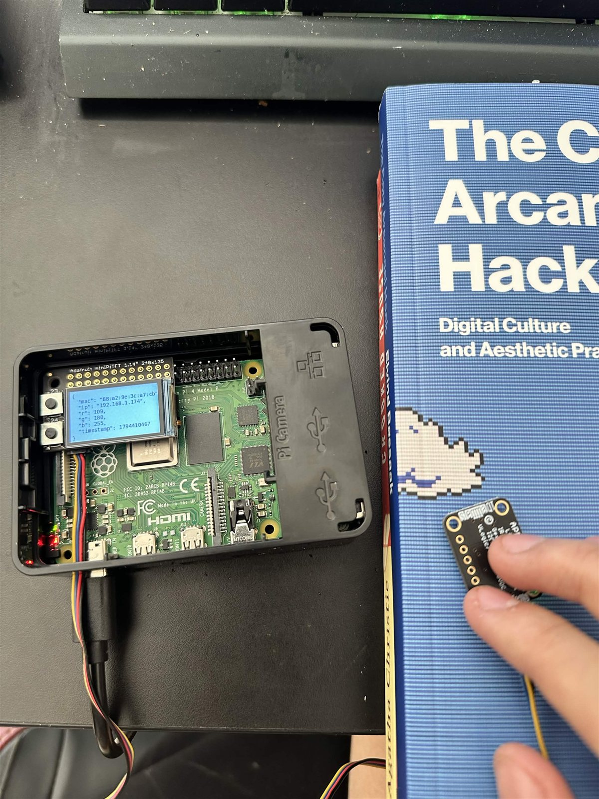

Sensor on a red book:

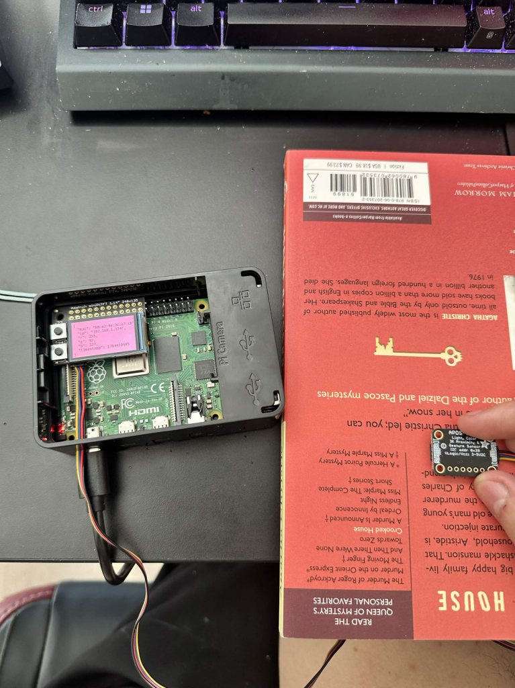

## Part C: Shared Garden

### 1. Project description

Shared Garden is a three-person game about raising one plant. Each person has one job:

- **Water.** Turning a rotary encoder clockwise tips a watering can on the screen and water pours out. Turning it back stops the water.
- **Mulch.** Moving a joystick left and right spreads mulch around the plant.
- **Sun.** Holding a button down brings the sun out.

The plant needs these in order: water, then mulch, then sun. That is one round. Three rounds in a row and the plant blooms into a flower. If anyone acts out of turn, the plant withers and the group starts again from round one.

Nobody can win alone, and anybody can ruin it for everyone, so people have to watch the screen and each other. The screen shows whose turn it is with a big hint line and three step cards.

**How I built it with one Pi.** The design is three Pis, one per station. I only have one Raspberry Pi 4, so I did two things:

1. I built each of the three sensor stations as a working prototype on my Pi 4, and ran and photographed each one. The station code takes a `--role` and is the same code three separate Pis would run.
2. For playing with three people at once, a phone (or any browser) can take the place of any station. The phone page has a matching control (a slider for the can, a rub pad for mulch, a hold button for sun). The laptop publishes the phone's input to the same MQTT topic the Pi station uses, so the game cannot tell them apart except for a `"from"` label in the message.

**MQTT evidence with one Pi.** Even without three Pis, I was able to produce real MQTT evidence. My Pi published its sensor readings to the course broker. The stand-in pages published to the same topics through the laptop. The display only moved when those messages came back from the broker. The MQTT panel, the message counts and the video in the build section all come from that live traffic.

### 2. Architecture diagram

```text
INPUT                                  COMMUNICATION                       COMPUTATION            OUTPUT

Pi 4 station (one --role per run)
  rotary encoder ──→ garden/water ─┐
  joystick ────────→ garden/mulch ─┼──MQTT──┐
  button ──────────→ garden/sun ───┘        │
        ▲                                   ▼
        └────────MQTT garden/state───── Course broker ──MQTT──→ Laptop Flask server
                                        farlab:1883               · check each message
Phone station (stands in for a Pi)          ▲                     · fill the step meters
  slider / rub pad / hold button            │                     · enforce the order
        │                                   │                     · count rounds
        └──HTTP──→ Laptop ──MQTT garden/<role>                          │
                                                                   HTTP /api/state
                                                                        ▼
                                                                Browser: animated plant,
                                                                can and sun, hints,
                                                                live MQTT panel
```

Output also goes back to the stations. The laptop publishes the game state to `garden/state` twice a second. The Pi subscribes to it and shows "YOUR TURN" on its screen, and the sun button's light blinks when it is time for sun.

A web page cannot speak MQTT directly, which is why the phone goes through the laptop. Its messages still go out to the broker and come back through the same subscription as the Pi's.

### 3. Build documentation

**Hardware.** All three sensors plug into the Pi 4 through the Mini PiTFT's Qwiic port and can be chained together.

| Station | Sensor | I2C address | Run with |
|---|---|---|---|
| Water | Adafruit I2C rotary encoder (seesaw) | `0x36` | `pi_publisher.py --role water` |
| Mulch | SparkFun Qwiic Joystick | `0x20` | `pi_publisher.py --role mulch` |
| Sun | SparkFun Qwiic Button | `0x6F` | `pi_publisher.py --role sun` |

**The three station prototypes.** I ran each one on the Pi by itself first, with `--sensor-only`, which reads the sensor and prints what it would publish without connecting to the broker (2026-11-11).

Water: the rotary encoder. The Pi's screen shows the tilt and the encoder's light gets bluer as the can tips.

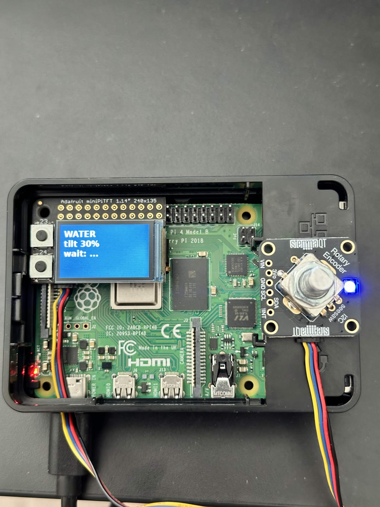

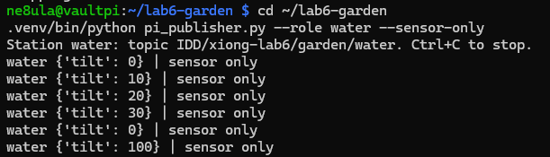

Mulch: the joystick. Moving it left and right adds to the "spread" count. Video: [pi-mulch.mp4](evidence/pi-mulch.mp4)

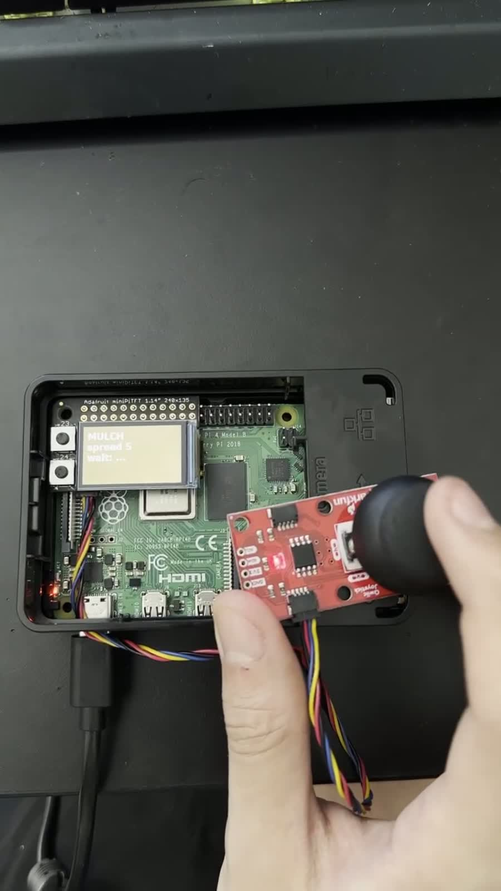

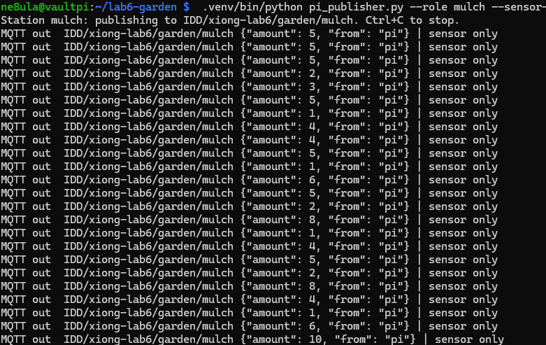

Sun: the button. Holding it lights the button and turns the Pi's screen yellow. Video: [pi-sun.mp4](evidence/pi-sun.mp4)

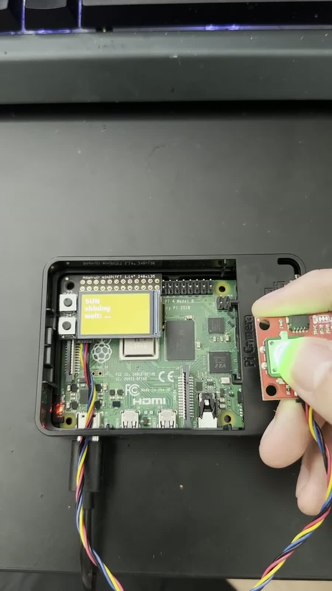

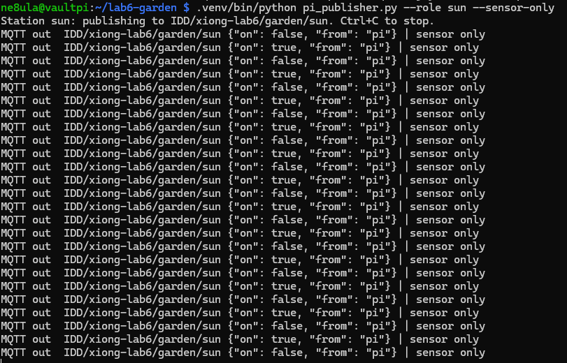

**MQTT topics** (team `xiong-lab6`):

| Topic | Sent by | Example message | Meaning |
|---|---|---|---|
| `IDD/xiong-lab6/garden/water` | Water station | `{"tilt": 60, "from": "pi"}` | How far the can is tipped, 0 to 100. It pours from 30 up, faster the further it tips. |
| `IDD/xiong-lab6/garden/mulch` | Mulch station | `{"amount": 3, "from": "pi"}` | How far the joystick travelled since the last message. 0 means "still here". |
| `IDD/xiong-lab6/garden/sun` | Sun station | `{"on": true, "from": "pi"}` | Whether the button is held. |
| `IDD/xiong-lab6/garden/state` | Laptop | `{"mode": "growing", "cycle": 1, "step": "mulch", "meter": 40, "hint": "..."}` | Whose turn it is. The Pi station subscribes. |

`"from"` is `"pi"` for a sensor station and `"phone"` when a phone is standing in. Each station sends on every change and once a second in between. If a station goes quiet for three seconds the laptop treats it as idle, so a station that loses Wi-Fi mid-pour cannot keep watering. The Pi also leaves a last-will message with the broker for the same reason. Nothing is retained, because an old message should never count as someone acting now.

**Seeing the MQTT traffic.** There are three places to watch it, and I used them as evidence:

- The **MQTT panel on the display**: one row per topic with its latest message and a running count, and a log of recent changes underneath.
- The **laptop terminal**: prints `MQTT in` for every change that arrives from the broker and `MQTT out` for every message it publishes for a phone.
- The **Pi terminal**: prints `MQTT out` for every message the sensor station publishes and `MQTT in` when the turn changes.

**A full run** (2026-11-11). The Pi ran the mulch station with the joystick. Water and sun used the stand-in pages, which I opened in two Chrome tabs on the laptop instead of on two phones. Their messages are still labelled `"from": "phone"` because that is the page they came from.

The setup: the garden on the left of the monitor, the two stand-in tabs on the right, and the Pi with the joystick in front.

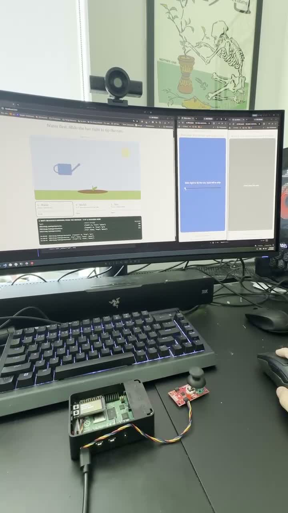

Getting it wrong. I spread mulch while it was time for sun, so the plant withered and the game went back to round one.

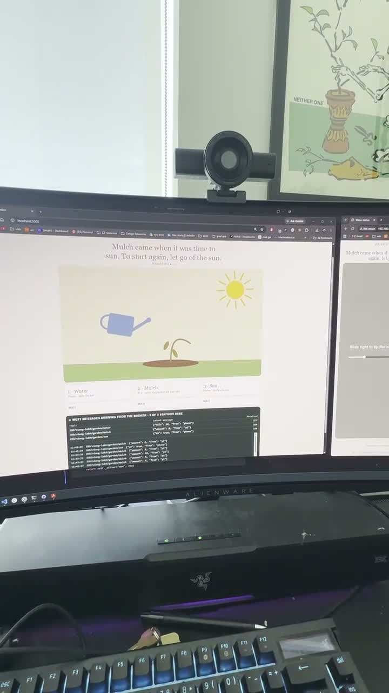

Getting it right. Three rounds in order and the plant bloomed. The step cards show which device held each job, and the MQTT panel shows all three stations present.

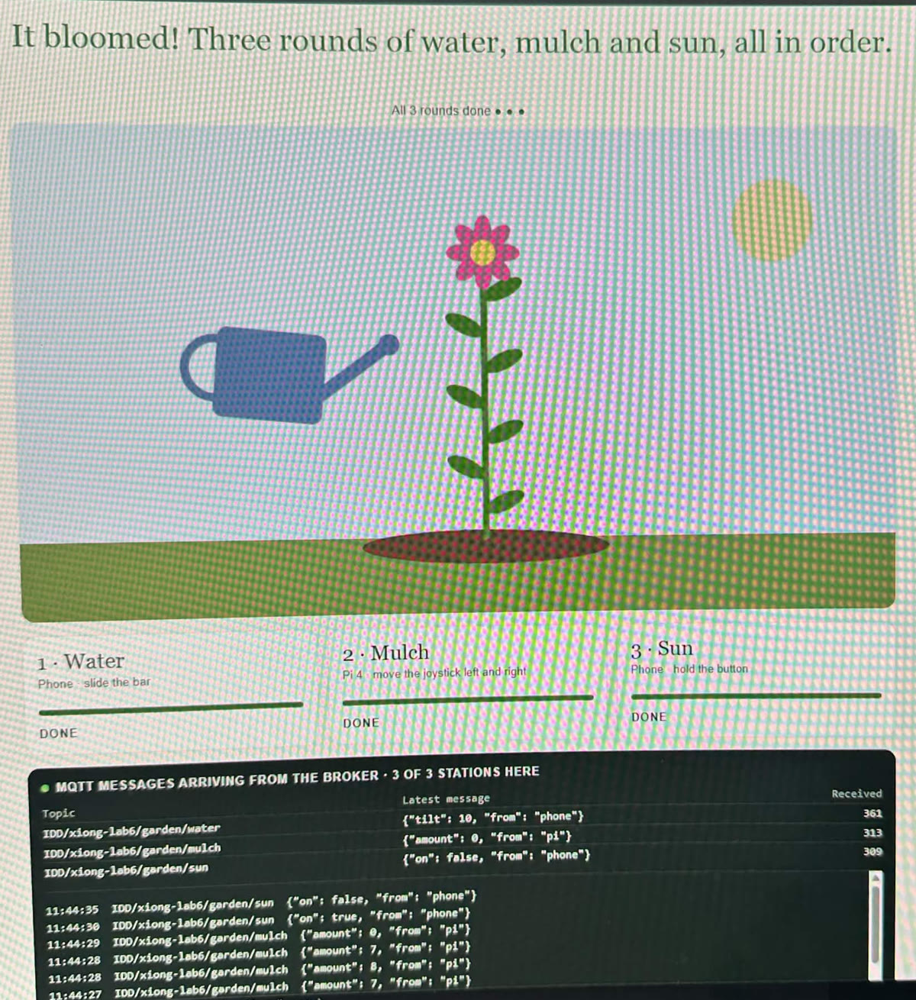

Video of the run, with a wither and then the rounds in order: [garden-run.mp4](evidence/garden-run.mp4)

**MQTT evidence from that run:** This is the display's MQTT panel. Each row is one topic with its latest message and how many messages have arrived on it. The log underneath shows the joystick's mulch messages arriving from the Pi (`"from": "pi"`) and the sun messages from a stand-in tab (`"from": "phone"`), all through the broker. I took this screenshot just after unplugging the Pi, which is why it says 2 of 3 stations; the bloom photo above shows 3 of 3 while it was running.

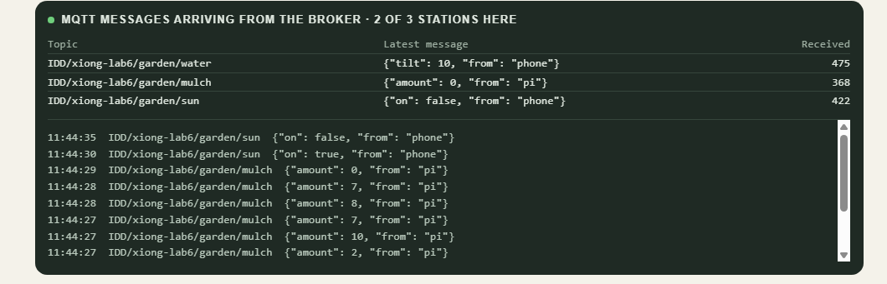

**Code:**

| File | Responsibility |
|---|---|
| [pi_publisher.py](pi_publisher.py) | The sensor stations. `--role water`, `--role mulch` or `--role sun`. |
| [app.py](app.py) | Laptop: MQTT subscription, phone relay, state broadcast, MQTT log, web pages |
| [state.py](state.py) | The rules: meters, order, rounds, wither, bloom |
| [common.py](common.py) | Topic names and shared settings |
| [static/app.js](static/app.js) | The animation and the MQTT panel |
| [templates/phone.html](templates/phone.html) | The phone stand-in for each station |

The encoder turns clicks into tilt, ten points per click (`pi_publisher.py`):

```python
position = sign * encoder.position
tilt = max(0, min(100, tilt + TILT_STEP * (position - last)))   # 10 per click
```

The joystick counts sideways travel. Small wobbles are ignored so a stick at rest sends nothing:

```python
x = stick.get_horizontal()  # 0-1023, about 512 at rest
if abs(x - anchor) >= STICK_DEADBAND:
    travel += abs(x - anchor)
    anchor = x
```

The laptop fills the water meter only while the can is pouring, and moves on only once the meter is full and the can is tipped back (`state.py`):

```python
if role == "water":
    if pouring:
        self.meter = min(100, self.meter + WATER_RATE * self.tilt / 100 * dt)
    elif self.meter >= 100:
        self._next(now)  # full, and the can is tipped back
```

Out-of-turn input withers the plant. There is a 1.5 second grace period after each step so a finger still on the button does not count:

```python
if now - self.since >= GRACE:
    if pouring and role != "water":
        return self._wither("water", now)
    if sunny and role != "sun":
        return self._wither("sun", now)
```

The water on screen is simulated drop by drop. Each drop leaves along the spout, faster the further the can is tipped, and then falls under gravity (`static/app.js`):

```js
const along = angle - 0.72, speed = 60 + 1.4 * view.tilt;
drops.push({x: tip.x, y: tip.y, vx: speed * Math.cos(along), vy: speed * Math.sin(along), ...});
...
d.vy += 900 * dt;  // gravity
d.x += d.vx * dt;
d.y += d.vy * dt;
```

### 4. User testing

**Not yet conducted.** I have only played it myself so far. I still need to run it with at least two people from outside the project and record what they expected before trying.

### 5. Reflection

This is based on building it and playing it myself. I will add more after the user tests.

**What worked well**

- The order rule works as a game. In my run the plant bloomed after three rounds in order, and it withered when I spread mulch during the sun step.
- One station program covers all three sensors. I pick the job with `--role`, so the code is what three separate Pis would run.
- Swapping a sensor for a stand-in page needed no change to the game, because both publish to the same topic.
- The MQTT panel made the traffic easy to see while playing. I could watch the joystick's messages arrive from the Pi next to the ones from the stand-in tabs.

**Challenges with distributed interaction**

- I only had one Pi. I borrowed a second one but could not log in to it, so I changed the plan to three prototypes on one Pi plus stand-in pages.
- The course's hosted pixel grid was down when I did Part B, so I ran the course server on my laptop.
- A station can disappear at any moment. I gave each station a once-a-second heartbeat and the laptop treats three seconds of silence as "gone". When I unplugged the Pi the display dropped to 2 of 3 stations.
- Messages do not stop the instant a step ends. A finger can still be on the button when the turn changes, so I added a 1.5 second grace period before out-of-turn input counts.

**How the sensor events worked**

- The encoder reports a position. I turn the change in position into tilt, ten points per click. It counted the opposite way from what I expected at first, so I flipped the sign.
- The joystick reports where the stick is. I add up how far it travels sideways and send that as an amount from 1 to 10. Small wobbles are ignored.
- The button reports pressed or not pressed, and its light comes on while it is held.
- Water and sun are states that hold until they change. Mulch is a stream of small events. Both kinds are sent on every change and once a second.
- The Mini PiTFT stayed black with the pin setup from the course's Part B code. A two-colour test showed which chip select pin my Pi needed.

**What I would improve**

- Test it with real people. That is the biggest gap.
- Run the stand-in pages on actual phones. I used two browser tabs on the laptop.
- Build it on three real Pis so nothing has to be swapped.
- Let a phone talk to the broker directly, so it does not depend on the laptop.
- Mulch messages can be lost if the network drops, because they are sent once with no confirmation. A lost message means a little less mulch.
